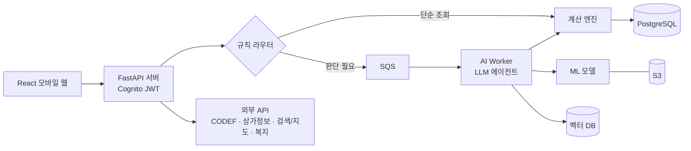

# 머니쿠션 (Money Cushion)

> 사회초년생 청년을 위한 멀티에이전트 기반 AI 금융 웰니스 서비스
> SK네트웍스 Family AI 캠프 33기 · 4팀

첫 월급을 받은 사회초년생이 **월급을 어떻게 나눌지**, **다음 월급날까지 얼마를 더 써도 되는지**, **예상치 못한 지출 뒤 계획을 어떻게 되살릴지**를 함께 판단해 주는 AI 금융 코치입니다.

| 항목 | 내용 |
|---|---|
| 대상 | 첫 소득과 독립적인 금융생활을 시작한 사회초년생 (매월 급여를 받는 사용자) |
| 이용 조건 | 본인 은행 계좌 1개 이상 연결 필수 (CODEF) · 카드 · 대출 조회는 선택 · **조회 전용** (송금 · 결제 · 가입 · 대출 실행 없음) |
| 제공 형태 | React 모바일 웹 (React Native 앱은 후속) |
| 기간 · 인원 | 2026. 9. 28. ~ 11. 20. (8주) · 3명 |

---

## 핵심 개념

| 용어 | 의미 |
|---|---|
| **안전 소비액** (더 써도 되는 돈) | 다음 급여일까지 확정 지출 · 최소생활비 · 저축 · 쿠션을 지키고도 더 쓸 수 있는 금액. 부족하면 부족액으로 표시 |
| **일일 권장액** (하루 생활비) | 남은 생활비 ÷ 다음 급여일까지 남은 날 |
| **머니 쿠션** | 생활비 · 저축과 분리한 돌발 지출 대비 예비비 (기본 목표: 월급의 3배) |
| **보호 조건** | 최소 생활비 · 저축 · 쿠션 하한처럼 어떤 조정안에서도 깨지면 안 되는 조건 |
| **자물쇠** | 사용자가 고정한 카테고리. 에이전트가 금액을 바꾸지 않음 |
| **사용자 승인** | AI는 제안만 하고, 계산 엔진 검수를 통과한 안을 사용자가 승인해야 새 예산 버전으로 저장 |

---

## 기능과 구현 범위

| 단계 | 기능 |
|---|---|
| **1차 (MVP)** | 회원 · 계좌 연결 · 초기 설정 · 예산 설계 (추천 예산 1개 · 자물쇠) · 거래 자동 분류 · 예산 조정 · 통합 챗봇 · 머니 쿠션 |
| **2차** | 소비 리포트 · 예산 변경 이력 · 소액 돌발 지출 · 알림 |
| **3차** | 큰 지출 상담 (동의 기반 복지 검색 · 대출 비교) |
| 검증 후 채택 | 카드 OCR |
| 후순위 | 일정 · 예정 지출 (Google Calendar) · 목표 · 청년 정책 추천 · 예적금 · 카드 추천 · React Native 앱 |
| 제외 | 공동 결제 정산 · 출금 계좌 잔액 부족 알림 · 구매 상담 |

1차 통합 점검 후 2차 → 3차 순서로 붙입니다. 상세 요구사항은 [`산출물/01_기획/4팀_요구사항정의서.xlsx`](산출물/01_기획/)를 기준으로 합니다.

---

## 시스템 구성



- **규칙 라우터 · 빠른 조회**: 잔액 · 더 써도 되는 돈은 LLM 없이 DB · 계산 엔진으로 즉시 처리. 라우터도 LLM 없이 버튼 · 진입점으로 에이전트와 모드를 정함
- **역할 분리**: LLM은 의도 해석 · 우선순위 판단 · 재분배안 작성 · 설명 / ML은 분류 · 비율 · 또래 소비 예측 / **금액은 계산 엔진만** 계산 · 검수
- **검수 후 승인**: 예산에 영향을 주는 변경은 엔진 검수 통과안만 보여주고 승인 후 반영. 검수 실패 시 재생성 최대 3회, 이후 사용자 확인으로 전환
- **버튼 기반 통합 챗봇**: 첫 화면 자유 입력 없이 선택지 3개. 1차에서는 미출시 기능 선택지를 '준비 중'으로 비활성

### 멀티에이전트

| 에이전트 | 하는 일 | 단계 |
|---|---|---|
| 라우터 (규칙) | 버튼 · 진입점으로 담당 에이전트와 모드 지정 | 1차 |
| ① 거래 분류 | ML 1차 분류 → 확신도 낮으면 검색 · 지도 + LLM 판단 → 불명확하면 사용자 확인 | 1차 |
| ② 예산 설계 | 방향별 비율(규칙) → ML 카테고리 비율 → LLM 보정 → 엔진 검증 | 1차 |
| ③ 예산 조정 | 엔진이 조정 가능 금액 계산 → LLM 재분배안 → 엔진 검수 → 사용자 승인 | 1차 |
| ④ 큰 지출 상담 | 부족 금액 계산 → (동의 시) ④-1 복지 검색 · ④-2 대출 비교 → 결과 통합 | 3차 |

> 작업당 LLM 호출 10회 이하 · 재생성 3회 이하. 에이전트는 DB를 직접 변경하지 않습니다.

### ML 모델

| 모델 | 쓰임 | 학습 데이터 | 기준선 → 평가 | 단계 |
|---|---|---|---|---|
| 거래 분류 (ML-001) | 거래 유형 · 소비 카테고리 | 상가(상권)정보 API · 검증 거래 표본 | 규칙 · 사전 · n-gram → macro-F1 | 1차 |
| 카테고리 비율 예측 (ML-003) | 예산 설계 | MDIS · KOSIS 가계동향조사 | 평균 · 규칙 → MAE · 사용자 수정률 | 1차 |
| 또래 비교 회귀 (ML-004) | 소비 리포트 | MDIS · KOSIS 가계동향조사 | 평균 → R² · 잔차 | 2차 |

---

## 기술 스택 (안)

| 영역 | 기술 |
|---|---|
| 모바일 웹 | React |
| 백엔드 API | Python · FastAPI · Amazon Cognito (JWT) |
| AI · 에이전트 | 규칙 라우터 + LLM 에이전트 4개 (AI Worker) |
| ML | 거래 분류 · 카테고리 비율 예측 · 또래 비교 회귀 |
| 데이터 | PostgreSQL (RDS) · 벡터 DB · S3 |
| 인프라 | AWS EC2 · Docker Compose · SQS · CloudWatch |
| 외부 연동 | CODEF (계좌 · 카드 · 대출) · 상가정보 API · 검색/지도 · MDIS/KOSIS · 복지서비스 API |

나머지 기술은 팀 숙련도와 최소 구현 검증 결과로 확정합니다.

---

## 데이터 원칙

- 개발 · 시연은 **합성 · 모의 데이터**로 진행하고, 실제 개인정보를 로그 · 데모에 노출하지 않습니다.
- 원본 · AI 후보 · 사용자 확정 값을 분리 저장하고, 계산은 같은 시점 자료의 스냅샷으로 수행합니다.
- 토큰 · 계좌번호는 암호화 · 마스킹하고, 외부 API에는 필요한 최소 조건만 전달합니다.
- API 키 · 원본 데이터는 커밋하지 않습니다.

---

## 팀 · 역할

| 이름 | ML | 에이전트 | 연계 · 공통 |
|---|---|---|---|
| 김나은 (PM) | 카테고리 비율 예측 | ② 예산 설계 · ③ 예산 조정 | 계산 엔진 · 공통 검수 · 승인 흐름, 머니 쿠션 · 돌발지출, DB 스키마 |
| 김혜리 (APM) | 거래 분류 | ① 거래 분류 · 라우터 · 통합 챗봇 | CODEF · 거래 원장 · 검색/지도 API, 알림, API 서버 통합 |
| 권세진 | 또래 비교 회귀 | ④ 큰 지출 상담 (④-1 복지 검색 · ④-2 대출 비교) | 자금 계산 엔진 · 복지/대출 데이터, 소비 리포트, 배포 |

---

## 일정

| 주차 | 기간 | 주요 작업 |
|---|---|---|
| 1주 | 09.28 – 10.02 | 요구사항 정의서 · WBS |
| 2주 | 10.06 – 10.08 | 프로젝트 기획서 · 화면설계서 · 수집 데이터 보고서 |
| 3주 | 10.12 – 10.16 | v5 기획 · DB 설계 · 화면 프로토타입 · **중간 발표 (10/16)** |
| 4주 | 10.19 – 10.23 | ML 기준선 · React 초기 설정 · 라우터 · 챗봇 골격 · 벡터 DB |
| 5주 | 10.26 – 10.30 | (1차) 예산 설계 → 조정 → 승인 · 거래 분류 · 홈 · 머니 쿠션 |
| 6주 | 11.02 – 11.06 | 1차 MVP 통합 점검 · 단일 LLM 비교 · (2차) 소액 돌발 · 알림 |
| 7주 | 11.09 – 11.13 | (3차) 큰 지출 상담 · 통합 테스트 · 결함 수정 |
| 8주 | 11.16 – 11.20 | 모바일 웹 최종 배포 · 시연 영상 · **최종 발표 (11/20)** |

---

## 저장소 구조

```
.
├── README.md
└── 산출물/
    ├── 01_기획/                  # 요구사항 정의서 · WBS · 프로젝트 기획서
    ├── 02_데이터 수집 및 저장/
    ├── 03_데이터 전처리/
    ├── 04_모델링 및 평가/
    ├── 05_서비스 배포 및 테스트/
    └── 06_발표 및 최종 제출/        # 중간 · 최종 발표 자료
```

소스 코드 디렉터리는 개발을 시작하면서 추가합니다.
