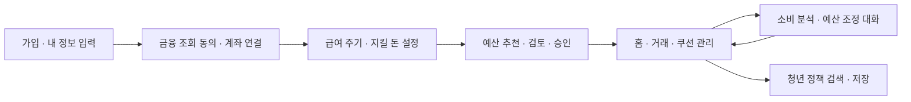
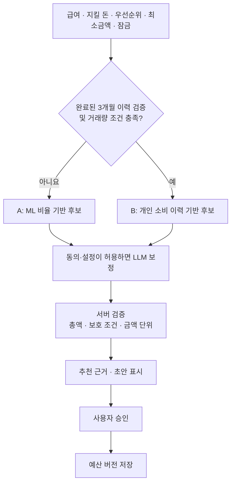

# 머니쿠션 (Money Cushion)

> **월급을 나누고, 소비를 이해하고, 예상 밖 지출에 대비하는 사회초년생의 AI 금융 코치**
>
> SK네트웍스 Family AI 캠프 33기 · 4팀

머니쿠션은 금융 거래를 모아 **지켜야 할 돈과 쓸 수 있는 생활비를 구분**하고, 개인의 소비 이력과 우선순위를 반영해 예산을 설계하는 모바일 웹 서비스입니다. 사용자는 챗봇에서 소비를 분석하고 예산 조정을 요청하거나, 자신의 조건에 맞는 청년 정책을 찾아볼 수 있습니다.

**AI는 요청을 해석하고 후보를 제안합니다. 금액 계산과 보호 조건 검증은 서버가 수행하고, 예산 변경은 사용자가 승인해야 반영됩니다.**

| 항목 | 내용 |
|---|---|
| 대상 | 정기적인 급여를 받으며 독립적인 금융생활을 시작하는 사회초년생 |
| 핵심 기능 | 금융 조회·거래 분류 → 예산 설계 → 소비 분석·예산 조정 → 비상자금 관리·청년 정책 검색 |
| 제공 형태 | React 기반 모바일 웹 + Django REST API |
| 금융 연동 범위 | CODEF 계좌·카드·대출 **조회**. 송금·결제·금융상품 가입·대출 실행은 제공하지 않음 |
| 프로젝트 기간 | 2026.09.28 ~ 2026.11.20 · 3명 |
| 문서 기준 | **2026.11.16 저장소 구현 기준**. 기능 활성화 조건과 모델 평가 범위는 아래에 별도 표기 |

[주요 기능](#주요-기능) · [핵심 설계](#핵심-설계) · [아키텍처](#시스템-아키텍처) · [모델과 평가](#데이터ml-모델과-평가) · [실행 방법](#로컬-실행) · [검증](#테스트와-검증) · [문서](#상세-문서)

## 해결하려는 문제

사회초년생에게 필요한 것은 지출 내역을 확인하는 데서 한 걸음 더 나아가, **다음 월급일까지 생활하면서 무엇을 줄이고 무엇을 지킬지 판단하는 일**입니다.

| 사용자 고민 | 머니쿠션의 접근 |
|---|---|
| “월급은 들어왔는데 얼마를 생활비로 잡아야 할까?” | 급여 주기와 고정지출·저축·쿠션을 먼저 확인한 뒤 카테고리별 생활비를 배분 |
| “처음 시작해서 쌓인 거래가 별로 없어.” | 통계 기반 ML 비율을 사용하는 설계 A와 검증된 개인 이력을 사용하는 설계 B를 구분 |
| “식비가 왜 늘었지? 다른 예산에서 옮겨도 될까?” | 기간·카테고리·결제 패턴을 서버에서 집계하고, 보호 조건을 지키는 조정안을 비교·승인 |
| “월세나 취업 준비에 받을 수 있는 지원이 있을까?” | 지역·신청 기간·자격 조건을 확인하며 청년 정책을 검색하고 원문과 함께 제시 |

## 주요 기능



| 기능 | 현재 코드에 구현된 내용 | 주요 구현 |
|---|---|---|
| 금융 연결·거래 관리 | 계좌·카드·대출 조회, 동기화, 취소·이체·카드값·상환 연결, 거래 분류 및 사용자 수정 | [finance](backend/finance/) |
| 급여·지킬 돈 | 급여일·실수령액·주기 변경, 고정지출·정기 저축 후보 확인, 카드 청구·납부 상태 반영 | [budgets](backend/budgets/) |
| 예산 설계 | 통계 기반 A / 개인 이력 기반 B, 최소금액·우선순위·자물쇠·유지 목표 반영, 추천 근거와 승인 | [design_service.py](backend/budgets/design_service.py) |
| 홈·머니쿠션 | 남은 생활비·하루 금액·여윳돈, 카테고리 초과·큰 지출 안내, 쿠션 목표·보호 기록 | [home.py](backend/budgets/home.py), [cushion.py](backend/budgets/cushion.py) |
| 소비 분석 | 자연어 조건 해석, 기간 비교, 금액·건수·평균·시간대 등 분석, 근거 기반 설명, 조건부 ML 비교 | [spending_analysis](backend/spending_analysis/) |
| 예산 조정 | 자연어 요청·추가 질문, 재원별 조정 가능액 계산, 변경 전후 제안, 명시적 승인·새 버전 저장 | [adjustment_core](backend/budgets/adjustment_core/), [adjustment_service.py](backend/budgets/adjustment_service.py) |
| 청년 정책 | 벡터·키워드 검색, 지역·기간·자격 확인, 결과 검토·재검색, 정책 상세·북마크 | [policies](backend/policies/) |
| 동의·데이터 관리 | 금융 조회 범위별 동의·철회, 예산 AI 선택 동의, 연결 해제·회원 탈퇴·삭제 처리 | [users](backend/users/) |

**구현 여부와 실행 환경의 활성화 여부는 다릅니다.** 기본 설정은 `CHAT_ENGINE=legacy`, `CHAT_LLM=fake`, `BUDGET_DESIGN_ENABLED=false`입니다. 위 AI 경로를 확인하려면 [기능별 실행 조건](#기능별-실행-조건)의 설정·모델·데이터를 준비해야 합니다. 배포 설정 파일의 존재만으로 운영 환경의 활성화나 배포 성공을 뜻하지 않습니다.

초기 기획의 큰 지출 상담·대출 상품 비교 대신 현재 통합 챗봇은 **소비 분석·예산 조정·청년 정책**을 연결합니다. 대출 조회·상환 관리는 구현되어 있지만 대출 상품 비교·신청과는 구분합니다. 카드 OCR, 캘린더 연동, 네이티브 앱은 현재 제공 범위에 포함하지 않습니다.

## 핵심 설계

### 1. AI 판단과 금액 계산을 분리

| 역할 | 담당하는 일 | 결과를 통제하는 방법 |
|---|---|---|
| LLM | 문장 의도·조건 해석, 후보 선택·보정 제안, 분석·검색 진행 판단 | 구조화된 입력·출력 계약, 허용된 도구·후보와 응답 검사 |
| ML | 상호명 분류, 생활비 배분 비율, 조건별 월 소비 참고 금액 | 모델·입력·출력 검증, 모델별 평가 지표와 적용 범위 관리 |
| 서버 계산·검증 | 거래 집계, 정수 원 금액 배분, 조정 가능액, 총액·하한·잠금 검사 | 같은 기준 자료로 재검산하고 조건 충돌 시 승인 차단 |
| 사용자 | 모호한 거래 확정, 보호 조건 설정, 제안 검토·승인 | 초안과 승인 예산 분리, 변경 전후 금액 확인 |

자연어의 유연함을 사용하면서도 **모델의 출력이 검증 없이 예산으로 저장되는 것을 막기 위한 설계**입니다. 에이전트의 제안과 서비스의 DB 저장 책임도 분리합니다.

멀티에이전트 구조는 업무별로 필요한 도구와 상태가 다르다는 점에 맞췄습니다. 거래 분류는 금융 동기화 과정에서, 예산 설계는 추천 요청에서 실행됩니다. 대화 라우터는 소비 분석·예산 조정·청년 정책 담당을 연결하며, 각 담당은 자신의 조회·계산·검색 도구를 사용합니다. 모든 작업을 하나의 프롬프트에서 처리하지 않고 기능별로 오류와 회귀 검사를 추적할 수 있습니다.

### 2. 거래 이력에 따라 다른 예산 설계



- **설계 A — 이력 부족:** CatBoost가 예측한 카테고리 비율을 바탕으로 사용자의 우선순위·최소금액·잠금을 적용합니다.
- **설계 B — 이력 충분:** 완료된 최근 3개월의 수집 범위와 거래 정합성을 확인한 뒤 개인 소비 패턴·일회성 지출을 반영합니다. 현재 분기 조건은 **10개 카테고리 중 하나 이상에서 3개월 합산 양수 소비 건수가 10건 초과**입니다. 전체 거래 건수와 다릅니다.
- 두 경로 모두 ML 참조를 사용하며, 선택 이유·모델 정보·입력 스냅샷을 추천 근거로 남깁니다. LLM 외부 보정은 별도 설정과 유효한 사용자 동의가 있을 때만 수행합니다.
- 자료가 불완전하거나 보호 조건을 함께 지킬 수 없으면 필요한 확인 사항을 반환합니다. 추천·승인 시점의 기준이 달라졌다면 오래된 안을 그대로 적용하지 않습니다.

근거: [A/B 선택](scripts/budget_design/plan_selection.py), [이력 검증](backend/finance/history_verifier.py), [설계 서비스](backend/budgets/design_service.py), [초안 검증](backend/budgets/recommend.py).

### 3. 돈의 성격과 소비 범위를 구분

| 개념 | 현재 구현의 의미 |
|---|---|
| 급여 주기 | 달력의 1일~말일이 아닌 사용자의 급여 기준 기간 |
| 지킬 돈 | 생활비 배분 전에 확인하는 고정지출·저축·쿠션 등 보호 대상 |
| 남은 생활비 | 생활비 배정액에서 해당 범위의 사용액을 뺀 금액. 홈·예산 화면은 최소 0원으로 표시하고 초과·부족액을 별도 관리 |
| 하루 금액 | 남은 생활비를 **내일부터 주기 종료 전날까지**의 일수로 나눈 정수 원 금액. 나눌 날이 없으면 표시하지 않음 |
| 여윳돈 | 아직 배정하지 않은 금액에서 사용·예약 등을 반영한 잔여 재원. 남은 생활비와 구분하여 표시 |
| 머니쿠션 | 기본 목표는 월 실수령액의 3배이며 직접 목표 금액 설정 가능. 예산 승인에 따른 계획상 보호 기록과 실제 적립 기록을 구분 |
| 최소금액·자물쇠 | 카테고리에 남겨야 할 하한과 사용자가 고정한 금액. 조정 시 보호 조건으로 검사 |
| 예산 밖 지출 | **주거·통신, 여행·숙박**은 현재 생활비 배분·차감에서 제외하고 별도로 안내. 거래 목록과 전체 소비 분석에는 남음 |

예를 들어 생활비 예산이 600,000원이고 해당 범위의 소비가 200,000원이면 남은 생활비는 400,000원입니다. 나눌 날이 10일이면 하루 금액은 40,000원입니다. 별도의 여윳돈이나 쿠션을 이 생활비에 임의로 더하지 않습니다.

카드 승인내역·은행 출금·취소·카드값·본인 계좌 이체를 구분하는 이유도 같은 지출을 중복 집계하지 않기 위해서입니다. 거래 연결 상태와 조회 범위가 불명확하면 확인 필요 상태를 유지합니다. 쿠션의 계획상 보호액은 **실제 송금 완료나 별도 계좌 잔액을 의미하지 않습니다.**

근거: [생활비 범위](backend/budgets/scope.py), [재원 구분](backend/budgets/funds_overview.py), [거래 처리](backend/finance/pipeline.py).

### 4. 대화·분석·승인의 일관성

- **라우터:** 기능 버튼은 정해진 담당으로 연결하고, 자유 문장은 LLM으로 해석합니다. 소비 분석·예산 조정·청년 정책의 상태를 나눠 보관하며 전환·재개를 처리합니다.
- **소비 분석:** LLM이 읽은 기간·대상·지표를 서버 조회에 적용합니다. 평균 결제액을 상품 가격으로, 결제 건수를 실제 방문 횟수로 단정하지 않도록 근거를 검사합니다. 월 중간 누적 지출과 ML의 한 달 예측값도 그대로 비교하지 않습니다.
- **청년 정책:** pgvector 유사도와 키워드 순위를 RRF로 결합하고, 지역·신청 기간·자격을 확인합니다. 정책명·지원 내용·링크는 저장된 공고 근거를 사용하며 최종 수급 자격을 확정하지 않습니다.
- **예산 승인:** 제안 당시와 승인 시점의 기준을 비교하고 DB 트랜잭션·행 잠금·멱등성 키로 중복 반영을 방지합니다. 채팅에서 제안을 조회하거나 선택하는 것만으로 예산이 승인되지는 않습니다.
- **동시 요청:** 대화 버전과 선택지의 턴을 검사해 오래된 선택지나 동시에 처리된 응답이 현재 상태를 덮어쓰지 않도록 합니다.

근거: [챗봇 엔진](backend/chat/engine.py), [소비 분석](backend/spending_analysis/agent.py), [정책 검색](backend/policies/search.py), [조정 승인](backend/budgets/adjustment_service.py).

## 시스템 아키텍처


팀의 시스템 구성도입니다. **실선은 서비스 요청 흐름**, **점선은 배포·설치 흐름**을 나타냅니다. AWS 서울 리전(`ap-northeast-2`)에서 EC2의 Docker Compose로 웹·백엔드 컨테이너를 운영하고, 데이터는 RDS PostgreSQL에 저장하는 구성입니다.

| 구분 | 구성과 역할 |
|---|---|
| 사용자 접속 | 모바일 웹 → 탄력적 IP에 연결된 `sslip.io` 주소 → HTTPS → Caddy |
| 웹 컨테이너 | Caddy가 HTTPS와 React 빌드 파일을 제공하고 `/api/*` 요청을 백엔드로 전달 |
| 백엔드 컨테이너 | Gunicorn + Django REST framework에서 API·AI 에이전트·모델 추론 실행 |
| 데이터베이스 | RDS PostgreSQL + pgvector에 회원·거래·예산·청년 정책 및 임베딩 저장. 백엔드와 TLS로 통신 |
| 모델 전달 | S3에 보관한 모델·보조 파일을 설치 시 EC2 모델 폴더로 복사하고, 백엔드에 읽기 전용으로 마운트. 요청마다 S3에서 모델을 내려받는 방식은 아님 |
| 외부 연동 | OpenAI LLM·임베딩, CODEF 금융 조회(데모), 네이버·카카오 가맹점 검색, TypeSafe Jev 분류 판단 |
| 네트워크·권한 | EC2 외부 인바운드는 80/443, DB 접속은 EC2 보안 그룹으로 제한. EC2 역할과 GitHub 배포용 OIDC 역할 분리 |

애플리케이션 내부에서는 거래 분류·예산 설계와 대화 라우터가 연결한 소비 분석·예산 조정·청년 정책 모듈이 동작합니다. CatBoost 추론은 백엔드 컨테이너 안의 별도 Python 환경·프로세스를 사용합니다.

백그라운드 작업은 [config/tasks.py](backend/config/tasks.py)의 **프로세스 내부 스레드 + DB 작업 상태** 방식입니다. 서버가 종료되어 작업이 멈추면 lease 만료 후 실패 처리하고 다시 시도하도록 안내합니다. 영속 작업 큐·독립 Worker 전환은 후속 과제입니다.

### 기술 스택

| 영역 | 저장소에서 사용하는 기술 |
|---|---|
| Frontend | React 19 · React Router · Vite · lucide-react |
| Backend | Python 3.12 · Django 5.2 · Django REST framework · Gunicorn |
| 인증·API | Django 세션 · CSRF · camelCase JSON · OpenAPI/Swagger |
| AI | 구조화된 LLM 호출 · 직접 구현한 라우터/도구 흐름 · 정책 체인의 LangChain Core · Jev |
| ML | TF-IDF · LinearSVC · CatBoost · scikit-learn · pandas · NumPy |
| DB·검색 | PostgreSQL 17 · pgvector · 키워드/벡터 순위 결합 |
| 배포 구성 | Docker Compose · Caddy · AWS EC2/RDS/ECR/S3/SSM · IAM/OIDC · GitHub Actions |
| 테스트 | Django TestCase/unittest · Vitest · Node test runner · OpenAPI 검증 |

버전과 의존성은 [requirements.txt](requirements.txt), [requirements-production.txt](requirements-production.txt), [frontend/package.json](frontend/package.json)을 기준으로 합니다. CatBoost 추론은 웹 서버와 의존성이 섞이지 않도록 별도 Python 환경에서 실행합니다.

### CI/CD

[ci-cd.yml](.github/workflows/ci-cd.yml)은 PR과 `main` 변경 시 PostgreSQL 환경에서 백엔드 검사·마이그레이션 검사·테스트, 프론트 린트·테스트·빌드를 수행합니다. **PR은 CI를 수행하고, `main` 배포는 CI 성공 후 진행**합니다.

1. GitHub Actions가 OIDC로 AWS 배포 역할을 받아 서버·화면 Docker 이미지를 빌드하고 ECR에 업로드합니다.
2. Systems Manager의 `send-command`로 EC2에서 `deploy.sh`를 실행합니다.
3. EC2가 ECR 이미지를 내려받아 Docker Compose 서비스를 갱신합니다.
4. 배포 명령 완료 후 외부 HTTPS 헬스체크의 릴리스 태그가 배포 대상과 일치하는지 확인합니다.

S3의 모델·보조 파일 전달은 위 코드 이미지 배포와 별도의 설치 과정입니다. 구성도의 파일 3개는 배포 가이드 기준 `spending_category_svm.joblib`, `label_conflicts.csv`, `budget_allocation.joblib`이며, 월 소비 참고 모델 C를 사용하려면 해당 모델·메타데이터·평가 파일도 별도로 준비해야 합니다.

실행 설정은 [deploy](deploy/), 인프라·모델 준비 절차는 [AWS 배포 가이드](docs/AWS_DEPLOYMENT_GUIDE.md)를 참고하세요.

## 데이터·ML 모델과 평가

### 모델의 역할

| 모델 | 입력·데이터 | 출력과 서비스 사용 |
|---|---|---|
| 거래 분류 | 상가·통신판매업 정제 라벨, 정규화한 상호명 | 문자 TF-IDF + 보정된 LinearSVC로 10개 소비 카테고리 예측. 사용자 기억·규칙·검색·Jev·사용자 확인과 함께 사용 |
| 생활비 배분 | 가계동향조사 정제 자료의 20~34세 근로자 1인 가구. 연령·성별·소득·차량·고정비·배분할 생활비 | CatBoost로 10개 카테고리 비율 예측. 서비스는 생활비 범위에 맞춰 보호 조건과 금액 단위를 적용 |
| 월 소비 참고 | 가계동향조사 기반 프로필 입력, 별도 CatBoost 모델 C | 11개 소비 항목의 월 금액을 예측. 완전한 월 자료·예측 오차를 확인해 소비 분석의 참고 기준으로 사용 |

모델 파일·원자료는 저장소에 포함하지 않습니다. 전처리·학습·추론 코드는 [scripts](scripts/), 공유 가능한 집계 지표는 [reports/ml_models](reports/ml_models/)에 있습니다. 모델 C는 코드가 연결되어 있으나 공개된 두 집계 지표 파일의 평가 대상에는 포함되지 않습니다.

### 저장된 평가 결과

아래 수치는 **저장된 모델 평가 기록**이며, 서비스 전체의 정확도나 이번 README 수정 시 새로 실행한 평가가 아닙니다.

| 모델·평가 | 기록된 결과 | 해석 범위 |
|---|---|---|
| 거래 분류 SVM · 2026-10-26 정책 모델 | 학습 1,166,171행 / 검증 145,830행 · 정확도 **85.82%**, Macro-F1 **0.8234** | 정제된 상호명 라벨 검증셋 기준. 실서비스 거래의 분류 성능과 동일하지 않음 |
| 거래 분류 · 개발용 거래 189건 | 정확도 **87.30%**, 고정 10개 클래스 Macro-F1 **0.4581** | 독립 검수 전 임시 라벨이며 개발 중 확인한 자료. 독립 최종 테스트로 해석하지 않음 |
| 생활비 배분 CatBoost | 2019~2024년 7,936행 학습 · 시간순 CV 비율 MAE **5.3250%p** | 2022·2023·2024 검증의 조사 가중치 적용 연도 평균으로 33개 후보 중 선택 |
| 생활비 배분 · 사후 연도 평가 | 2025년 **5.3173%p**, 2026년 **5.3073%p** | 이미 확인한 사후 평가 자료. 새 독립 테스트가 아님 |

거래 분류 수치의 모델은 `20261026_books_content_beoltoon_v1`입니다. 11월 5일 문구 업종 보정 실험은 [모델 문서](docs/ML_MODELS.md)에 별도 기록되어 있으며 위 지표와 섞지 않습니다. 실행 환경의 모델 파일·SHA256을 대조해야 같은 모델의 결과인지 확인할 수 있습니다.

생활비 배분 모델은 **주어진 생활비 총액을 나누는 모델**입니다. 미래 총생활비나 절감 효과를 예측하는 모델이 아니며, MAE 5.3250%p를 “추천 정확도 94.675%”로 환산하지 않습니다. 월 소비 참고 금액 역시 실제 또래 집단의 평균이나 개인에게 적합한 소비 한도를 뜻하지 않습니다.

평가 근거: [SVM 지표](reports/ml_models/spending_classifier.json), [CatBoost 지표](reports/ml_models/budget_allocation.json), [데이터·모델 재현과 한계](docs/ML_MODELS.md).

## 로컬 실행

**준비:** Python 3.12, Node.js 22.22 이상, Docker, Git. 아래는 macOS/Linux 기준이며 Windows 단계는 [로컬 설치 가이드](docs/LOCAL_SETUP.md)에 있습니다.

### 1. 의존성·환경변수

```bash
git clone https://github.com/20260528-skn-family-ai-33/SKN33-Final-4Team.git
cd SKN33-Final-4Team
python3.12 -m venv .venv
source .venv/bin/activate
python -m pip install -r requirements.txt
cp .env.example .env
```

`.env`에서 `DJANGO_SECRET_KEY`, `POSTGRES_DB`, `POSTGRES_USER`, `POSTGRES_PASSWORD`, `CONNECTED_ID_ENCRYPTION_KEY`, `IDENTIFIER_HMAC_KEY`를 설정합니다. 두 암호 키는 **서로 다른 32바이트 URL-safe Base64 값**이어야 합니다. 기존 `.env`가 있으면 덮어쓰지 않고 필요한 항목만 확인합니다.

```bash
# 각각의 출력값을 해당 환경변수에 입력
python -c "from django.core.management.utils import get_random_secret_key; print(get_random_secret_key())"
python -c "import secrets,base64; print(base64.urlsafe_b64encode(secrets.token_bytes(32)).decode())"
python -c "import secrets,base64; print(base64.urlsafe_b64encode(secrets.token_bytes(32)).decode())"
```

### 2. PostgreSQL·백엔드

아래 `YOUR_LOCAL_PASSWORD`를 `.env`의 DB 비밀번호와 맞춥니다. DB명·사용자명을 변경했다면 명령의 값도 맞춥니다. 기존 DB 컨테이너가 있다면 재사용합니다.

```bash
docker run --name money-cushion-db \
  -e POSTGRES_DB=money_cushion \
  -e POSTGRES_USER=money_cushion \
  -e POSTGRES_PASSWORD=YOUR_LOCAL_PASSWORD \
  -p 5432:5432 -d pgvector/pgvector:pg17

python backend/manage.py migrate
python backend/manage.py runserver
```

### 3. 프론트엔드

별도 터미널의 저장소 루트에서 실행합니다.

```bash
cd frontend
npm ci
npm run dev
```

- 서비스 화면: [localhost:5173](http://localhost:5173)
- 개발 API 문서: [127.0.0.1:8000/api/docs/](http://127.0.0.1:8000/api/docs/)
- 런타임 API 확인: [127.0.0.1:8000/api/docs/runtime/](http://127.0.0.1:8000/api/docs/runtime/)

Vite가 `/api` 요청을 Django로 프록시합니다. 위 단계는 기본 서버 실행이며 실제 금융 조회·ML 추천·자연어 AI를 모두 활성화하지는 않습니다. Swagger의 계약 명세와 현재 실행 응답은 분리되어 있습니다.

### 기능별 실행 조건

| 확인할 기능 | 추가 준비 |
|---|---|
| 금융 조회 | CODEF 환경·키·연결 정보, 사용자 금융 조회 동의. 키 이름은 [.env.example](.env.example) 참고 |
| 거래 ML 분류 | `SPENDING_MODEL_PATH`의 SVM 가중치. 검색·Jev 보완에는 해당 API 키 필요 |
| 통합 챗봇 | `CHAT_ENGINE=router`. 실제 자연어 해석은 `CHAT_LLM=live`와 `OPENAI_API_KEY`, `LLM_MODEL` 필요 |
| 예산 A/B 설계 | `BUDGET_DESIGN_ENABLED=true`, `BUDGET_INFERENCE_PYTHON`, `BUDGET_MODEL_PATH` 및 [추론 의존성](scripts/budget_allocation/requirements-inference.txt). 기본 OFF에서는 임시 비율 추천 경로 사용 |
| 예산 설계 외부 보정 | 위 조건 + `BUDGET_DESIGN_EXTERNAL_ENABLED=true` + 현재 버전의 예산 설계 AI 동의 |
| 실제 LLM 예산 조정 | 라우터·live 설정 + 별도의 예산 조정 AI 동의. 설계 AI 동의와 구분 |
| 소비 분석의 선택적 확장 | `CHAT_EXPLAIN_PLAN=on`, `CHAT_AGENT=on`. 월 소비 ML 비교에는 `SPENDING_REFERENCE_ROOT` 아래 모델 C·메타데이터·평가 파일과 `BUDGET_INFERENCE_PYTHON` 추론 환경 필요 |
| 청년 정책 검색 | 적재된 정책·임베딩 데이터, live 설정과 **적재 시와 동일한** `EMBEDDING_MODEL`. [정책 데이터 준비](docs/agents/청년정책.md) 참고 |

`fake`는 고정 해석을 사용하는 개발·테스트용 대역입니다. 임의의 문장을 실제 LLM처럼 이해하지 않으며, 가짜 임베딩으로 실제 정책 벡터 검색 품질을 평가할 수 없습니다. 외부 서비스 키를 입력해도 별도로 배포하지 않은 모델·정책 데이터가 자동으로 생성되지는 않습니다.

## 테스트와 검증

### 재현 가능한 검사

환경변수와 로컬 PostgreSQL이 준비된 상태에서 실행합니다. Django DB 테스트에는 테스트 DB 생성 권한이 필요합니다. 기능별 일부 검사는 모델 파일·외부 실행 조건이 없으면 건너뛰므로 결과의 `skipped`도 함께 확인합니다.

```bash
# 저장소 루트: 백엔드 설정·스키마 변경 여부
python backend/manage.py check
python backend/manage.py makemigrations --check --dry-run

# 서비스 회귀 검사 (청년 정책 포함)
python backend/manage.py test users finance budgets chat config spending_analysis policies --noinput

# 고정된 합성 자료를 사용하는 별도 로컬 fixture 검사
python backend/manage.py test spending_fixture chat.test_engine \
  --settings=spending_fixture.settings --noinput

# OpenAPI 계약·예시·생성 파일 최신 여부
python -m pip install -r requirements-docs.txt
python scripts/build_openapi.py --check --validate
```

```bash
# frontend/에서
npm run lint
npm test
npm run build
```

| 검증 대상 | 확인하는 위험 | 근거 |
|---|---|---|
| 예산 설계·승인 | 총액 불일치, 최소금액·잠금 위반, 오래된 추천 승인, 동의 없는 외부 보정 | [test_design_service.py](backend/budgets/test_design_service.py), [test_design_consent.py](backend/budgets/test_design_consent.py), [test_design_integration.py](backend/budgets/test_design_integration.py) |
| 예산 조정 | 기준 자료 변경, 중복 승인, 재원·보호 조건 오류 | [test_adjustment_service.py](backend/budgets/test_adjustment_service.py), [test_adjustment_reference_locking.py](backend/budgets/test_adjustment_reference_locking.py) |
| 거래·개인정보 | 중복 저장, 동기화 중 철회·삭제, 만료 작업의 늦은 결과 반영 | [test_concurrency.py](backend/finance/test_concurrency.py), [test_stale_work.py](backend/finance/test_stale_work.py), [test_codef_privacy.py](backend/finance/test_codef_privacy.py) |
| 소비 분석 | 기간·대상 혼동, 자료 누락을 0원으로 오인, 근거 밖 설명 | [spending_fixture](backend/spending_fixture/), [spending_analysis](backend/spending_analysis/) |
| 정책 검색 | 지역·기간·자격 불일치, 검색 순위와 실제 적합성의 차이 | [policies/tests](backend/policies/tests/), [정책 평가 도구](backend/policies/eval/README.md) |
| 사용자 화면 | 동의·추천·조정·승인 흐름, API 오류와 재시도 | [frontend/src/pages](frontend/src/pages/), [frontend/src/components](frontend/src/components/)의 테스트 |

자동 회귀 검사, 합성 데이터 기반 서비스 검사, 실제 LLM 평가는 구분합니다. 저장된 LLM 응답을 재생한 통과율은 새 모델 호출의 성능이 아닙니다. [라우터 평가 기록](reports/router_eval/README.md)과 [소비 분석 검증 기록](backend/spending_fixture/README.md)에는 평가 조건·실패 사례·재검증 범위를 남겨 두었습니다.

2026.11.16 문서 갱신 시 `build_openapi.py --check --validate`로 **69개 API·158개 모델·447개 예시**의 검증과 생성 파일 최신 여부를 확인했습니다. 이는 API 계약 검증 결과이며 전체 서비스 회귀 테스트나 실제 외부 연동의 통과를 의미하지 않습니다.

### 심사·시연에서 확인할 흐름

1. **예산 설계:** 급여·지킬 돈·우선순위를 설정하고 추천 근거를 확인합니다. 이력이 적은 사용자와 충분한 사용자의 A/B 선택 이유를 비교합니다.
2. **소비 분석:** “지난달보다 식비를 더 썼어?” 다음 “그럼 교통비는?”을 입력해 기간 맥락과 근거를 확인합니다.
3. **예산 조정:** “식비를 5만 원 늘리고 싶어”를 요청하고 재원·보호 조건·변경 전후 금액을 검토합니다. 승인 전후 예산 버전을 비교합니다.
4. **실패·보호 동작:** 최소금액·잠금이 충돌하거나 자료가 부족한 경우 확인 요청과 승인 차단을 확인합니다.
5. **청년 정책:** 지역과 고민을 입력하고 정책 근거·신청 기간·확인할 조건을 본 뒤 북마크합니다.

실제 금융자료 없이 확인하려면 [합성 fixture 안내](backend/spending_fixture/README.md)를 사용합니다. 고정 fixture는 소비 분석 검증용이므로 실제 금융 연결이나 모든 기능의 종단 간 시연을 대체하지 않습니다.

## 개인정보·동의 처리

- 금융기관 로그인 비밀번호를 보관하는 대신 CODEF 연결 후 `connectedId`를 **AES-GCM**으로 암호화하여 저장합니다. 계좌·카드·대출 식별용 중복 확인 키는 별도의 HMAC 키로 만듭니다.
- 금융 조회 동의를 은행·카드·대출 범위로 구분하고, 예산 설계·조정 AI 동의는 각각 별도로 기록합니다. 문서 버전·해시와 철회 상태를 검사합니다.
- 동의 철회·연결 해제·탈퇴 시 조회 원자료와 파생 자료의 처리 범위를 구분합니다. 진행 중인 작업과의 충돌 및 외부 삭제 실패에 대한 재처리 상태를 관리합니다.
- 예산 설계 외부 호출에는 정해진 요약 항목을 사용합니다. 대화 입력과 외부 전송 범위는 기능별 동의 문서를 기준으로 하며, 모든 기능이 동일한 데이터를 전송한다고 가정하지 않습니다.
- API 키·암호 키·실제 금융 원자료·모델 가중치는 README나 Git에 포함하지 않습니다. 합성 fixture와 집계 평가 자료는 실제 사용자 데이터와 구분합니다.

근거: [connected_id.py](backend/finance/connected_id.py), [identifiers.py](backend/finance/identifiers.py), [privacy.py](backend/users/privacy.py), [deletion.py](backend/users/deletion.py), [consent_documents.py](backend/users/consent_documents.py).

## 현재 한계와 개선 과제

| 항목 | 현재 한계 · 다음 검증 과제 |
|---|---|
| 거래 분류 | 상호명만으로 구매 품목을 확정할 수 없는 다품목·동명 가맹점이 존재. 실거래 독립 라벨 평가와 자동 확정 임계값 재검증 필요 |
| 추천 품질 | 모델 비율 오차와 사용자에게 유용한 예산은 다른 평가 대상. 실제 수정률·승인율·지속 사용·절감 효과의 사용자 검증 필요 |
| 데이터 범위 | 가계 통계의 분류 단위·결측 처리·학습 집단에 따른 한계. 청년 전체나 다양한 가구 형태로 일반화하지 않음 |
| 자연어 분석 | 문장 표현·맥락에 따라 해석이 달라질 수 있음. 고정 사례 회귀와 실제 LLM 평가를 나누어 확대 필요 |
| 정책 최신성 | 저장된 공고·벡터에 의존. 정기 수집·갱신과 공고 원문 확인 필요 |
| 백그라운드 처리 | 프로세스 내부 스레드 방식. 작업량 증가·서버 재시작에 대응하는 영속 큐·독립 Worker 전환은 후속 과제 |
| 서비스 검증 | 공개 저장소만으로 모델·금융 키·정책 데이터를 모두 재현할 수 없음. 배포 환경별 활성화·실제 사용자 시나리오 확인 필요 |

## 저장소 구조

```text
.
├── frontend/                  # React 화면 · 공통 컴포넌트 · 팝업 · UI 테스트
├── backend/
│   ├── config/                # 설정 · API 라우팅 · 공통 응답 · 작업 상태 · OpenAPI
│   ├── users/                 # 회원 · 프로필 · 동의 · 개인정보 삭제
│   ├── finance/               # CODEF · 원장 · 거래 연결 · 분류 · 동기화
│   ├── budgets/               # 급여 · 보호 금액 · 설계 · 조정 · 승인 · 쿠션
│   ├── chat/                  # 대화 상태 · 라우터 · LLM 호출 · 에이전트 연결
│   ├── spending_analysis/     # 소비 조회 · 분석 · 근거 검사 · ML 참고
│   ├── policies/              # 정책 정규화 · 검색 · 자격 · 대화 · 저장
│   └── spending_fixture/      # 합성 소비 자료 · 별도 DB 설정 · 회귀 검사
├── scripts/                   # 전처리 · ML 학습/추론 · 예산 실험 · 평가 도구
├── tests/                     # 전처리 · ML · 예산 설계 등 독립 테스트
├── reports/                   # 공유 평가 지표 · 라우터 응답 기록
├── docs/                      # 환경 · API · DB · 모델 · 에이전트 · 배포 문서
├── deploy/                    # Dockerfile · Compose · Caddy · 배포 스크립트
├── .github/workflows/         # CI/CD
└── 산출물/                     # 기획 · 데이터 · 모델링 · 테스트 · 발표 산출물
```

## 팀과 역할

| 이름 | 주요 담당 |
|---|---|
| 김나은 · PM | 생활비 카테고리 배분 모델, 예산 설계·조정, 계산·공통 검증·승인 흐름, 머니쿠션·돌발지출, DB 스키마 |
| 김혜리 · APM | 거래 분류 모델·에이전트, 라우터·통합 챗봇, CODEF·거래 원장·검색 연동, 알림·API 통합 |
| 권세진 | 월 소비 참고 모델, 소비 분석·청년 정책, 자금 계산·복지/대출 데이터, 배포 |

DB 마이그레이션은 팀의 DB 담당자와 조율하여 작성하고, 다른 개발자는 공유된 마이그레이션을 `migrate`로 적용합니다.

## 상세 문서

| 목적 | 문서 |
|---|---|
| 환경·실행 | [로컬 설치](docs/LOCAL_SETUP.md) · [환경변수](docs/ENV_SETUP.md) · [프론트엔드 가이드](docs/FRONTEND_GUIDE.md) |
| API·DB | [API 규칙](docs/API_RULES.md) · [기능별 API](docs/api/README.md) · [OpenAPI](docs/openapi/openapi.yaml) · [Swagger](docs/SWAGGER.md) · [DB 모델](docs/DB_MODELS.md) |
| AI·데이터 | [ML 모델](docs/ML_MODELS.md) · [예산 설계](docs/agents/budget_design.md) · [거래 분류](docs/agents/거래분류.md) · [청년 정책](docs/agents/청년정책.md) · [거래 이력 검증](docs/finance_history_verifier.md) |
| 평가·배포 | [라우터 평가](reports/router_eval/README.md) · [소비 분석 fixture](backend/spending_fixture/README.md) · [정책 평가](backend/policies/eval/README.md) · [AWS 배포](docs/AWS_DEPLOYMENT_GUIDE.md) |
| 프로젝트 산출물 | [기획부터 최종 발표까지](산출물/) |

상세 문서에는 과거 실험·인계 기록도 포함되어 있습니다. 실행 동작은 현재 코드와 설정을, 과거 평가 수치는 해당 기록의 모델 버전·데이터·평가 시점을 함께 확인하세요.
