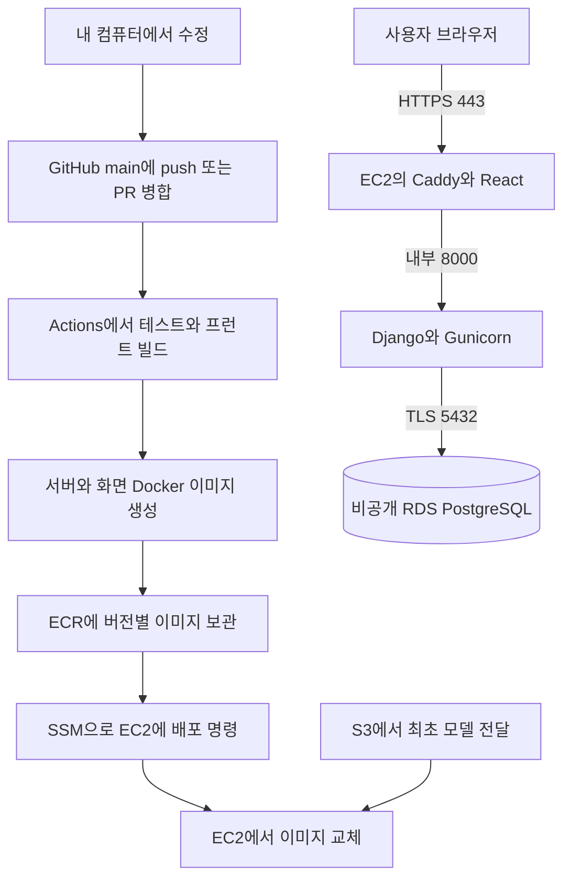

# 머니쿠션 AWS 배포와 GitHub Actions 자동 배포 가이드

작성 기준: 2026년 11월 9일 · AWS 한국어 콘솔 · 서울 리전 `ap-northeast-2`

목표는 **처음 한 번 EC2와 RDS를 설정한 뒤, GitHub의 `main`에 코드가 올라오면 검사에 통과한 버전이 사이트에 자동 반영되게 만드는 것**입니다. GitHub 배포를 처음 하는 팀원을 기준으로 클릭할 메뉴, 실행할 위치, 입력값, 성공 확인 방법을 순서대로 설명합니다.

현재 저장소의 React·Vite, Django 5.2, Python 3.12, PostgreSQL 17에 맞춘 구성입니다. 도메인을 사지 않고, 고정 IP로 만드는 무료 주소(sslip.io)를 씁니다. 예제 파일은 [deployment/examples](deployment/examples)에 있으며 **현재는 문서용 예제이므로 자동 실행되지 않습니다.** 아래 복사 단계를 진행해야 실제 배포 설정이 생깁니다.

EC2 한 대와 단일 AZ RDS를 사용하는 소규모 시연 구성입니다. 배포 중 짧은 중단이 생길 수 있습니다. 웹·DB 연결 성공과 전체 금융 기능 검증은 별도이므로 마지막 기능 점검까지 진행하세요.

## 1 전체 흐름 이해하기



| 용어 | 이 프로젝트에서 하는 일 |
|---|---|
| EC2 | 24시간 켜 두는 리눅스 컴퓨터. 화면과 Django 실행 |
| RDS | PostgreSQL 관리형 DB. EC2를 교체해도 DB는 별도로 유지 |
| Docker 이미지 | 코드와 실행 환경을 묶은 배포 파일 |
| ECR | AWS 안에서 Docker 이미지를 보관하는 저장소 |
| CI | 코드가 합쳐질 때 테스트와 빌드로 오류를 확인 |
| CD | CI에 통과한 `main` 버전을 EC2에 적용 |
| OIDC | GitHub가 배포할 때만 AWS 임시 권한을 받는 인증 방식 |
| SSM | SSH 비밀키 없이 AWS를 통해 EC2에 명령을 전달하는 도구 |
| Caddy | HTTPS 인증서 발급·갱신, React 제공, Django 요청 전달 |
| 보안 그룹 | 어느 컴퓨터가 어느 포트에 접근할 수 있는지 정하는 방화벽 |

완성 후에는 `git push origin main` 또는 `main` 대상 PR 병합이 배포 시작점입니다. PR 생성 시에는 CI만 수행하고 배포하지 않습니다. 검사 실패 시 배포도 멈춥니다. 여러 커밋을 빠르게 올리면 대기 중인 옛 실행은 최신 실행으로 대체될 수 있습니다.

GitHub Pages는 사용하지 않습니다. GitHub Actions가 AWS 배포를 실행하고, 실제 서비스는 EC2에서 제공합니다.

## 2 준비물과 값을 적어 둘 표

다음 권한을 준비하세요.

- AWS 계정과 결제 수단, EC2·RDS·VPC·IAM·ECR·S3를 설정할 권한. 루트 계정은 MFA를 설정하고 일상 작업은 별도 관리 계정 또는 IAM Identity Center로 진행합니다.
- GitHub 저장소의 코드 수정 및 Actions Variables 설정 권한. 조직에서 제한하면 저장소 관리자에게 요청합니다.
- 내 컴퓨터에 Git과 코드 편집기. 로컬 개발 환경은 [LOCAL_SETUP.md](LOCAL_SETUP.md)를 참고합니다.
- 모델 담당자가 공유한 `spending_category_svm.joblib`, `label_conflicts.csv`와 확인용 SHA256 값.
- AWS 사용 예산. 가격은 생성 화면의 추정 비용으로 확인합니다.

저장소에는 두 Git 원격이 등록되어 있습니다. **이 가이드는 `origin`을 기준**으로 합니다.

| 구분 | 현재 확인한 저장소 |
|---|---|
| origin | `20260528-skn-family-ai-33/SKN33-Final-4Team` |
| camp | `SKNETWORKS-FAMILY-AICAMP/SKN33-FINAL-4Team` |

`camp`를 배포 기준으로 쓰려면 이후 IAM 신뢰 정책의 저장소 문자열과 GitHub 설정 대상도 모두 그 저장소로 바꿉니다. 한 저장소의 main에 올려도 다른 저장소의 Actions는 자동으로 실행되지 않습니다.

다음은 공개해도 되는 설정값입니다. 비밀번호와 API 키는 이 표에 적지 마세요.

| 항목 | 이 가이드의 값 또는 나중에 적을 값 |
|---|---|
| AWS 리전 | `ap-northeast-2` |
| AWS 계정 ID | 콘솔 오른쪽 위 계정 메뉴의 12자리 숫자 |
| VPC | `moneycushion-vpc`, 생성 후 `vpc-...` 기록 |
| EC2 역할 | `moneycushion-ec2-role` |
| EC2 인스턴스 ID | 생성 후 `i-...` 기록 |
| EC2 고정 IP | 탄력적 IP 할당 후 기록 |
| RDS 식별자 | `moneycushion-db` |
| DB 이름 | `money_cushion` |
| 앱 DB 사용자 | `money_cushion` |
| RDS 엔드포인트 | 생성 후 `...ap-northeast-2.rds.amazonaws.com` 기록 |
| ECR 저장소 | `moneycushion-backend`, `moneycushion-frontend` |
| GitHub 배포 역할 | `moneycushion-github-deploy` |
| 서비스 주소 | 탄력적 IP로 만든 `app.IP대시.sslip.io` 형태 (7.2) |
| 모델용 S3 버킷 | 전 세계에서 중복되지 않는 이름, 예: `moneycushion-models-계정ID` |

`ACCOUNT_ID`, `INSTANCE_ID`, `BUCKET_NAME`, `app.203-0-113-10.sslip.io`는 **본인 값으로 바꿀 자리**입니다. `203-0-113-10`은 설명용 IP이므로 그대로 입력하면 안 됩니다.

## 3 비용 알림부터 설정하기

**작업 위치: AWS 콘솔**

1. 콘솔 언어를 한국어로, 리전을 **아시아 태평양 서울**로 선택합니다. IAM처럼 전역 서비스는 리전 선택이 없을 수 있습니다.
2. 검색창에서 **결제 및 비용 관리 → Budgets 또는 예산 → 예산 생성**으로 들어갑니다.
3. 월별 비용 예산을 만들고 팀 예산에 맞는 금액과 알림 이메일을 입력합니다. 예를 들어 월 예산의 50%, 80%, 100%에 알림을 설정합니다.
4. 계정의 프리 티어·크레딧 적용 조건을 직접 확인합니다. 이 구성 전체가 무료라고 가정하지 마세요.

EC2·RDS 외에도 EBS, 공인 IPv4/탄력적 IP, ECR 이미지 저장, S3, 백업, 트래픽 비용이 있습니다. 예산 알림은 자동 과금 차단 기능이 아닙니다. 이 가이드는 NAT 게이트웨이를 생성하지 않습니다. 공인 IPv4도 과금 대상입니다. [AWS VPC 요금](https://aws.amazon.com/ko/vpc/pricing/)

**완료 기준:** 예산과 알림 수신 이메일이 저장되어 있습니다. [AWS 예산 생성 안내](https://docs.aws.amazon.com/ko_kr/cost-management/latest/userguide/budgets-create.html)

## 4 VPC와 보안 그룹 만들기

**작업 위치: AWS 콘솔**

### 4.1 VPC 만들기

1. **VPC → VPC 생성**을 누릅니다.
2. **VPC 등** 또는 VPC와 관련 리소스를 함께 만드는 옵션을 선택합니다.
3. 이름 자동 생성 접두사는 `moneycushion`, IPv4 CIDR은 `10.20.0.0/16`으로 설정합니다. 기존 연결망과 겹치면 다른 대역을 사용합니다.
4. 가용 영역 **2개**, 퍼블릭 서브넷 **2개**, 프라이빗 서브넷 **2개**를 선택합니다.
5. **NAT 게이트웨이 없음**, **VPC 엔드포인트 없음**, IPv6 없음으로 설정합니다.
6. DNS 호스트 이름과 DNS 확인 옵션은 켭니다.
7. 미리 보기에서 퍼블릭 서브넷에는 인터넷 게이트웨이로 가는 경로가 있고, 프라이빗에는 없는지 확인한 뒤 생성합니다.

EC2는 퍼블릭 서브넷에 두고 공인 IP로 패키지·SSM·ECR에 접속합니다. RDS는 프라이빗 서브넷에 두며 인터넷에서 직접 접속하지 않습니다. RDS의 서브넷 그룹에는 서로 다른 두 가용 영역의 서브넷이 필요합니다. [RDS 네트워크 구성](https://docs.aws.amazon.com/ko_kr/AmazonRDS/latest/UserGuide/USER_CreateDBInstance.html)

### 4.2 보안 그룹 두 개 만들기

**EC2 → 네트워크 및 보안 → 보안 그룹 → 보안 그룹 생성**에서 같은 VPC에 생성합니다.

**`moneycushion-web-sg`**

| 인바운드 유형 | 포트 | 소스 |
|---|---:|---|
| HTTP | 80 | `0.0.0.0/0` |
| HTTPS | 443 | `0.0.0.0/0` |

**`moneycushion-db-sg`**

| 인바운드 유형 | 포트 | 소스 |
|---|---:|---|
| PostgreSQL | 5432 | `moneycushion-web-sg`의 보안 그룹 ID 선택 |

DB 규칙의 소스는 EC2 IP가 아니라 **EC2에 붙일 보안 그룹**입니다. 아웃바운드는 처음에는 기본 전체 허용을 사용합니다. 22·8000·5173 포트는 추가하지 않습니다. 서버 관리는 SSM으로 진행하며 Django 8000 포트는 컨테이너 내부에만 있습니다.

**완료 기준:** 같은 VPC 안에 두 그룹이 있으며 DB 5432 소스가 `sg-...`로 표시됩니다.

## 5 ECR과 EC2용 IAM 역할 만들기

**작업 위치: AWS 콘솔**

### 5.1 ECR 저장소 두 개 만들기

1. **Amazon ECR → 프라이빗 레지스트리 → 리포지토리 → 리포지토리 생성**으로 이동합니다.
2. `moneycushion-backend`를 생성합니다. 태그 변경 불가 설정을 선택합니다.
3. 같은 방법으로 `moneycushion-frontend`를 생성합니다.
4. 두 저장소 URI가 다음 형태인지 확인합니다.

```text
ACCOUNT_ID.dkr.ecr.ap-northeast-2.amazonaws.com/moneycushion-backend
ACCOUNT_ID.dkr.ecr.ap-northeast-2.amazonaws.com/moneycushion-frontend
```

예제는 `커밋SHA-실행ID-재실행번호`를 이미지 태그로 사용합니다. 재실행해도 같은 태그를 덮어쓰지 않고 이전 버전을 구분할 수 있습니다.

### 5.2 EC2 역할 만들기

1. **IAM → 역할 → 역할 생성**으로 이동합니다.
2. 신뢰할 수 있는 엔터티에서 **AWS 서비스**, 사용 사례에서 **EC2**를 선택합니다.
3. 권한 정책 `AmazonSSMManagedInstanceCore`를 찾아 선택합니다.
4. 역할 이름을 `moneycushion-ec2-role`로 지정하고 생성합니다.
5. 역할 상세에서 **권한 추가 → 인라인 정책 생성 → JSON**을 선택합니다.
6. [ec2-ecr-read.json](deployment/examples/iam/ec2-ecr-read.json)을 열어 `ACCOUNT_ID`를 본인 계정 ID로 모두 바꾸고 붙여 넣습니다.
7. 정책 이름을 `moneycushion-ecr-read`로 저장합니다.

이 역할은 EC2가 SSM에 연결하고 지정한 ECR 두 곳에서 이미지를 가져오는 권한입니다. GitHub가 사용할 역할은 뒤에서 따로 만듭니다. [SSM 인스턴스 역할](https://docs.aws.amazon.com/ko_kr/systems-manager/latest/userguide/session-manager-getting-started-instance-profile.html)

## 6 EC2 생성과 서버 접속

**작업 위치: AWS 콘솔**

1. **EC2 → 인스턴스 → 인스턴스 시작**을 누릅니다.
2. 이름: `moneycushion-web`.
3. AMI: Canonical의 **Ubuntu Server 24.04 LTS**, 아키텍처 **64비트 x86**. ARM은 이번 예제와 맞지 않습니다.
4. 인스턴스 유형: 시작 예시는 **t3.medium**입니다. ML 가중치를 여러 프로세스에서 읽는 점을 고려한 4 GiB 메모리 출발점이며, 실제 부하에 맞춰 조정합니다. 무료 등급이라는 뜻은 아닙니다.
5. 키 페어: **키 페어 없이 계속 진행**. SSM 접속을 사용합니다.
6. 네트워크 설정 편집: 앞에서 만든 VPC, **퍼블릭 서브넷**, **퍼블릭 IP 자동 할당 활성화**, 기존 `moneycushion-web-sg` 선택.
7. 스토리지: 예시 **gp3 30 GiB**, 암호화 활성화. 모델·이미지 크기에 따라 늘립니다.
8. **고급 세부 정보 → IAM 인스턴스 프로파일**에서 `moneycushion-ec2-role`을 선택합니다.
9. 메타데이터 옵션은 IMDSv2 필수로 설정합니다. 앱에 AWS 권한이 필요하지 않아 컨테이너에 별도 AWS 키를 넣지 않습니다.
10. **사용자 데이터**에 [bootstrap-ec2.sh](deployment/examples/deploy/bootstrap-ec2.sh)의 전체 내용을 붙여 넣습니다. `#!/usr/bin/env bash`부터 마지막 줄까지 복사합니다. 비밀번호는 넣지 않습니다.
11. 설정과 예상 비용을 검토한 뒤 인스턴스를 시작합니다.

설치 스크립트는 SSM Agent, Docker, Compose 플러그인, AWS CLI v2, PostgreSQL 클라이언트를 준비합니다. 새 Ubuntu 인스턴스용입니다. [Docker 공식 설치 절차](https://docs.docker.com/engine/install/ubuntu/), [Ubuntu SSM Agent 안내](https://docs.aws.amazon.com/ko_kr/systems-manager/latest/userguide/agent-install-ubuntu-64-snap.html)

몇 분 뒤 인스턴스 상태 검사 통과를 기다린 다음 **인스턴스 선택 → 연결 → Session Manager 또는 세션 관리자 → 연결**을 누릅니다. 새 브라우저 터미널에서 실행합니다.

```bash
sudo cloud-init status --wait
sudo docker --version
sudo docker compose version
aws --version
aws sts get-caller-identity
```

Compose는 `env_file.format: raw`를 지원하는 **2.30.0 이상**이 필요합니다. 예제 설치는 공식 저장소의 현재 버전을 설치합니다. [Compose 환경 파일 형식](https://docs.docker.com/reference/compose-file/services/#format)

**완료 기준:** 설치 상태가 `done`, Docker·Compose·AWS CLI 버전이 표시되고, AWS 호출 결과 ARN에 EC2 역할 이름이 보입니다. 설치 실패 시 아래 로그를 확인합니다.

```bash
sudo tail -n 100 /var/log/cloud-init-output.log
```

Session Manager에 연결 자체가 안 되면 IAM 역할 연결, 퍼블릭 서브넷의 `0.0.0.0/0 → igw-...` 경로, 공인 IP, 아웃바운드 443, SSM Agent 상태를 확인합니다. **EC2 → 작업 → 모니터링 및 문제 해결 → 시스템 로그 가져오기**로 초기 설치 로그도 볼 수 있습니다. Agent 복구에 SSH가 필요하면 관리자와 EC2 Instance Connect 조건을 확인하고, 22번 포트를 임시로 **내 IP만** 허용한 뒤 복구 후 닫습니다.

## 7 고정 IP와 서비스 주소 준비하기

### 7.1 탄력적 IP 연결

**작업 위치: AWS 콘솔**

1. **EC2 → 네트워크 및 보안 → 탄력적 IP → 탄력적 IP 주소 할당**.
2. 서울 리전에서 할당합니다.
3. 할당한 주소를 선택하고 **작업 → 탄력적 IP 주소 연결**을 누릅니다.
4. 대상 인스턴스 `moneycushion-web`을 선택해 연결합니다.

EC2를 중지했다 다시 켜도 이 주소를 유지합니다. 사용 여부와 관계없이 비용 조건을 확인하세요.

### 7.2 서비스 주소 만들기 (sslip.io)

이 프로젝트는 `DEBUG=False`에서 세션·CSRF 쿠키를 HTTPS에만 전송합니다. 따라서 **IP로 HTTP 페이지가 보이는 것만으로 로그인 배포가 끝난 것이 아닙니다.** HTTPS 인증서는 IP가 아니라 주소(이름)에 발급되므로, 도메인을 사지 않고 [sslip.io](https://sslip.io)의 무료 주소를 씁니다. sslip.io는 주소 안에 적힌 IP를 그대로 돌려주는 DNS 서비스라서 따로 등록하거나 설정할 것이 없습니다.

1. 7.1에서 연결한 탄력적 IP의 점(`.`)을 대시(`-`)로 바꿉니다. 예: `203.0.113.10` → `203-0-113-10`
2. 앞에 `app.`, 뒤에 `.sslip.io`를 붙입니다. 예: `app.203-0-113-10.sslip.io`
3. 이 주소를 2장 값 기록표의 **서비스 주소** 칸에 적습니다. 이후 가이드의 `app.203-0-113-10.sslip.io`는 모두 이 값으로 바꿉니다.

| 확인할 것 | 이유 |
|---|---|
| 탄력적 IP를 꼭 연결 | IP가 바뀌면 주소도 바뀌어 인증서와 설정값(`SITE_DOMAIN`, `app.env`)을 다시 맞춰야 합니다 |
| IP는 대시 형태로 | 점 형태(`app.203.0.113.10.sslip.io`)보다 대시 형태가 인증서 발급이 단순합니다 |
| 발표 대비 | 무료 외부 DNS 서비스라서 장애가 나면 접속이 안 됩니다. 발표용 시연 녹화를 따로 준비합니다 |

### 7.3 주소 확인

**작업 위치: 내 컴퓨터 터미널**

```bash
dig +short app.203-0-113-10.sslip.io A
```

Windows PowerShell은 `nslookup app.203-0-113-10.sslip.io`를 사용합니다. 탄력적 IP가 나오면 준비된 것입니다. 아직 웹 컨테이너가 없어서 사이트는 열리지 않아도 정상입니다.

첫 배포 때 Caddy가 Let's Encrypt 인증서를 발급하고 HTTP를 HTTPS로 전환합니다. 발급 확인을 위해 보안 그룹의 80·443 포트가 열려 있어야 합니다. 발급에 실패하면 웹 컨테이너 로그를 확인하고 잠시 뒤 다시 배포합니다. 짧은 시간에 여러 번 실패하면 발급 횟수 제한에 걸릴 수 있습니다. [Caddy HTTPS 안내](https://caddyserver.com/docs/quick-starts/reverse-proxy)

## 8 RDS PostgreSQL 만들기

**작업 위치: AWS 콘솔**

1. **RDS → 서브넷 그룹 → DB 서브넷 그룹 생성**.
2. 이름 `moneycushion-db-subnets`, 앞에서 만든 VPC를 선택합니다.
3. 두 가용 영역의 **프라이빗 서브넷 두 개**를 선택하고 생성합니다.
4. **RDS → 데이터베이스 → 데이터베이스 생성 → 표준 생성**을 선택합니다.
5. 엔진 **PostgreSQL**, 버전 **17 계열에서 지원되는 최신 마이너 버전**을 선택합니다. Aurora가 아닙니다.
6. 템플릿은 **개발 및 테스트** 또는 계정에서 가능한 유사 옵션을 선택하고, 배포 옵션은 **단일 DB 인스턴스/단일 AZ**인지 직접 확인합니다.
7. DB 인스턴스 식별자: `moneycushion-db`.
8. 마스터 사용자: `postgres`. 자격 증명 관리는 **자체 관리**로 선택하고 강한 비밀번호를 비밀번호 관리자에 저장합니다. 이 값은 관리자 초기 설정에만 사용합니다.
9. DB 인스턴스 클래스: 시작 예시 **db.t4g.micro**, 스토리지 **gp3 최소 허용 용량**. 화면에서 지원하지 않는 조합이면 PostgreSQL 17용 최소 적합 클래스를 선택합니다. 메모리·연결 부족이 생기면 확장합니다.
10. 스토리지 자동 조정을 켜면 최대 용량을 예산에 맞춰 설정합니다.
11. 연결: **EC2 컴퓨팅 리소스에 연결하지 않음**을 선택해 직접 설정합니다. 같은 VPC, `moneycushion-db-subnets`를 선택합니다.
12. **퍼블릭 액세스 아니요**, 기존 보안 그룹 **`moneycushion-db-sg`만** 선택, 포트 `5432`.
13. 추가 구성의 **초기 데이터베이스 이름**에 `money_cushion`을 입력합니다. DB 식별자와 실제 DB 이름은 다릅니다.
14. 저장 암호화 활성화, 자동 백업 보존 기간 예시 **7일**, 삭제 방지 활성화. 추가 유료 모니터링 기능은 필요와 가격을 확인하고 선택합니다.
15. 생성 화면의 비용을 확인한 뒤 생성합니다.

상태가 **사용 가능**이 되면 DB 상세의 **연결 및 보안 → 엔드포인트**를 기록합니다. `https://`나 `:5432`를 붙이지 않은 호스트 이름입니다. [RDS PostgreSQL 시작 안내](https://docs.aws.amazon.com/ko_kr/AmazonRDS/latest/UserGuide/CHAP_GettingStarted.CreatingConnecting.PostgreSQL.html)

### 8.1 EC2에서 DB 사용자와 pgvector 준비

**작업 위치: EC2 Session Manager 터미널**

아래 `RDS_ENDPOINT`를 실제 엔드포인트로 바꿉니다. `-W`가 물으면 RDS 마스터 비밀번호를 입력합니다. 비밀번호가 화면에 안 보이는 것은 정상입니다.

```bash
sudo psql "host=RDS_ENDPOINT port=5432 dbname=money_cushion user=postgres sslmode=verify-full sslrootcert=/opt/moneycushion/certs/global-bundle.pem" -W
```

`money_cushion=>` 프롬프트가 나오면 아래 SQL을 **최초 한 번** 실행합니다.

```sql
CREATE ROLE money_cushion LOGIN;
\password money_cushion
GRANT CONNECT, TEMPORARY ON DATABASE money_cushion TO money_cushion;
GRANT USAGE, CREATE ON SCHEMA public TO money_cushion;
CREATE EXTENSION IF NOT EXISTS vector;
SELECT extname, extversion FROM pg_extension WHERE extname = 'vector';
\q
```

`\password`에서 입력하는 것은 **앱용 새 DB 비밀번호**입니다. RDS 마스터 비밀번호와 구분해 저장합니다. 재접속 시에는 이미 만든 역할을 다시 만들지 말고 필요한 확인 명령만 실행합니다.

현재 `finance/0009` 마이그레이션이 `vector` 확장을 요구하고 `0011`에서 관련 테이블을 삭제합니다. 최신 코드에 해당 테이블이 없어도 빈 DB에서는 과거 마이그레이션을 차례로 실행하므로 확장이 필요합니다. 관리자 권한이 필요한 확장은 미리 생성하고 앱에는 마스터 권한을 주지 않습니다. 지원 여부는 `SELECT name, default_version FROM pg_available_extensions WHERE name='vector';`로 확인합니다. [RDS PostgreSQL 확장](https://docs.aws.amazon.com/AmazonRDS/latest/UserGuide/Appendix.PostgreSQL.CommonDBATasks.Extensions.html)

연결은 RDS CA 인증서를 사용한 `verify-full`로 호스트와 인증서를 확인합니다. 인증서 만료·교체 시 CA 번들과 이미지를 갱신합니다. [RDS PostgreSQL SSL](https://docs.aws.amazon.com/ko_kr/AmazonRDS/latest/UserGuide/PostgreSQL.Concepts.General.SSL.html)

**완료 기준:** 앱용 사용자가 만들어졌고 `vector` 버전이 출력됩니다. 로컬 개발 DB 데이터는 자동 복사되지 않습니다. 초기 배포는 빈 RDS에서 시작합니다.

## 9 EC2에 운영 설정과 모델 준비하기

**작업 위치: EC2 Session Manager 터미널**

### 9.1 공개 설정 파일

```bash
sudo nano /opt/moneycushion/config.env
```

아래 내용을 넣고 `ACCOUNT_ID`, `app.203-0-113-10.sslip.io`를 바꿉니다. 주소에는 `https://`나 경로를 붙이지 않습니다.

```dotenv
AWS_REGION=ap-northeast-2
ECR_REGISTRY=ACCOUNT_ID.dkr.ecr.ap-northeast-2.amazonaws.com
SITE_DOMAIN=app.203-0-113-10.sslip.io
```

Nano 저장은 `Ctrl+O → Enter`, 종료는 `Ctrl+X`입니다. 이 파일은 셸에서 읽으므로 공백이나 임의 명령을 추가하지 말고 위 세 항목만 사용합니다.

### 9.2 비밀 설정 파일

세 키는 아래 명령으로 **각각 새로 생성해 비밀번호 관리자에 저장**합니다. 출력값을 GitHub나 채팅에 붙여 넣지 않습니다.

```bash
python3 -c 'import secrets; print(secrets.token_urlsafe(64))'
python3 -c 'import secrets,base64; print(base64.urlsafe_b64encode(secrets.token_bytes(32)).decode())'
python3 -c 'import secrets,base64; print(base64.urlsafe_b64encode(secrets.token_bytes(32)).decode())'
sudo nano /opt/moneycushion/app.env
```

파일 내용:

```dotenv
DJANGO_SETTINGS_MODULE=config.settings_production
DJANGO_SECRET_KEY=첫_번째_명령으로_생성한_값
DJANGO_DEBUG=False
DJANGO_ALLOWED_HOSTS=app.203-0-113-10.sslip.io,localhost,127.0.0.1
DJANGO_CSRF_TRUSTED_ORIGINS=https://app.203-0-113-10.sslip.io
POSTGRES_DB=money_cushion
POSTGRES_USER=money_cushion
POSTGRES_PASSWORD=앱용_DB_비밀번호
POSTGRES_HOST=RDS_ENDPOINT
POSTGRES_PORT=5432
CONNECTED_ID_ENCRYPTION_KEY=두_번째_명령으로_생성한_값
IDENTIFIER_HMAC_KEY=세_번째_명령으로_생성한_값
SPENDING_MODEL_PATH=/models/spending_category_svm.joblib
SPENDING_CONFLICTS_PATH=/models/label_conflicts.csv
CHAT_ENGINE=legacy
CHAT_LLM=fake
CODEF_ENV=demo
CODEF_DEMO_ID=
CODEF_DEMO_SECRET=
CODEF_PUBLIC_KEY=
TYPESAFE_API_KEY=
JEV_MODEL=jev-1.14.0
OPENAI_API_KEY=
LLM_MODEL=gpt-6-luna
KAKAO_REST_API_KEY=
NAVER_CLIENT_ID=
NAVER_CLIENT_SECRET=
DATA_GO_KR_SERVICE_KEY=
```

여기서는 인프라 연결을 먼저 확인하기 위해 기존 엔진과 fake 모드를 사용합니다. 실제 은행 연결·LLM·검색 검증 전에 필요한 키를 채우고 팀이 검증한 엔진/모델 설정으로 변경합니다. 자세한 항목은 [ENV_SETUP.md](ENV_SETUP.md)와 루트 `.env.example`을 참고합니다.

이 파일은 Compose의 **raw** 형식입니다. 한 줄에 `KEY=값`을 쓰고, 값에 따옴표를 씌우거나 줄 끝 주석을 붙이지 않습니다. `.env.example`의 따옴표도 그대로 복사하지 않습니다. 특히 CODEF 공개키는 전체를 한 줄로 넣습니다. 이 파일을 `source`로 실행하지 않습니다.

```bash
sudo chmod 600 /opt/moneycushion/config.env /opt/moneycushion/app.env
```

`CONNECTED_ID_ENCRYPTION_KEY`는 DB에 저장된 연결 정보를 복호화하는 키입니다. 매 배포 때 다시 생성하지 않습니다. 기존 DB를 이전한다면 기존 키도 안전하게 이전해야 합니다. RDS 백업만으로 이 키가 복구되지는 않으므로 별도로 보관합니다.

`IDENTIFIER_HMAC_KEY`는 계좌 · 대출 · 카드 번호로 중복 확인 키를 만드는 HMAC 키입니다. `CONNECTED_ID_ENCRYPTION_KEY`와 다른 값이어야 서버가 켜집니다. 이 키도 다시 생성하지 않고 별도로 보관합니다. 바뀌면 같은 계좌 · 카드를 새 행으로 저장합니다.

### 9.3 Git에 없는 모델 전달

현재 거래 분류기는 별도 모델 파일을 읽습니다. 웹 첫 화면이 떠도 파일이 없으면 거래 분류가 실패합니다. 예제 배포 스크립트는 두 파일의 존재를 확인한 뒤 진행합니다.

1. **AWS S3 → 버킷 → 버킷 만들기**에서 서울 리전의 일반 목적 버킷을 만듭니다. 이름 예: `moneycushion-models-계정ID`.
2. **모든 퍼블릭 액세스 차단 유지**, 기본 암호화 활성화. 예제는 기본 SSE-S3를 기준으로 합니다.
3. 버킷 안에 `models` 폴더를 만들고 팀이 공유한 두 파일을 업로드합니다. 실제 금융 원본 데이터는 올리지 않습니다.
4. **IAM → 역할 → moneycushion-ec2-role → 인라인 정책 추가**에 아래 정책을 저장합니다. `BUCKET_NAME`을 바꿉니다.

```json
{
  "Version": "2012-10-17",
  "Statement": [{
    "Effect": "Allow",
    "Action": "s3:GetObject",
    "Resource": "arn:aws:s3:::BUCKET_NAME/models/*"
  }]
}
```

EC2 터미널에서 다운로드합니다.

```bash
sudo aws s3 cp s3://BUCKET_NAME/models/spending_category_svm.joblib /opt/moneycushion/models/spending_category_svm.joblib
sudo aws s3 cp s3://BUCKET_NAME/models/label_conflicts.csv /opt/moneycushion/models/label_conflicts.csv
sudo chmod 644 /opt/moneycushion/models/spending_category_svm.joblib /opt/moneycushion/models/label_conflicts.csv
sudo sha256sum /opt/moneycushion/models/spending_category_svm.joblib /opt/moneycushion/models/label_conflicts.csv
```

출력 해시를 모델 담당자가 전달한 값과 대조합니다. `joblib`은 신뢰한 파일만 읽습니다. 모델 파일을 바꾸는 일은 코드 배포와 별도이며, 나중에 모델과 코드 버전도 함께 기록합니다. 예산 배분 등 추가 모델을 실제 API에 연결하면 해당 파일·추론 패키지도 추가해야 합니다. [현재 모델 공유 규칙](ML_MODELS.md)

**완료 기준:** 공개 설정·비밀 설정·모델 두 파일이 EC2에 있으며 모델 해시가 일치합니다.

## 10 GitHub Actions에 AWS 권한 연결하기

**작업 위치: AWS 콘솔**

### 10.1 OIDC 공급자

1. **IAM → 자격 증명 공급자 또는 ID 제공업체 → 공급자 추가**.
2. 공급자 유형 **OpenID Connect**.
3. 공급자 URL: `https://token.actions.githubusercontent.com`.
4. 대상 또는 Audience: `sts.amazonaws.com`.
5. 추가합니다. 같은 공급자가 이미 있으면 재사용합니다.

### 10.2 GitHub 전용 역할

1. **IAM → 역할 → 역할 생성 → 사용자 지정 신뢰 정책**.
2. [github-trust.json](deployment/examples/iam/github-trust.json)에서 `ACCOUNT_ID`를 바꾸고 JSON을 붙여 넣습니다.
3. 저장소가 `origin`과 다르면 `repo:소유자/저장소:ref:refs/heads/main`도 정확히 바꿉니다. 대소문자를 포함해 실제 GitHub 경로를 복사합니다.
4. 역할 이름 `moneycushion-github-deploy`로 생성합니다.
5. 역할 상세에서 **권한 추가 → 인라인 정책 생성 → JSON**.
6. [github-deploy.json](deployment/examples/iam/github-deploy.json)의 `ACCOUNT_ID`, `INSTANCE_ID`를 바꿔 붙여 넣고 `moneycushion-deploy`라는 이름으로 저장합니다.
7. 역할 상세 상단의 **ARN**을 복사합니다.

신뢰 정책은 지정 저장소의 `main`만 역할을 사용할 수 있게 합니다. 권한 정책은 지정 ECR 두 곳에 이미지를 올리고 지정 EC2에 배포 명령을 보내도록 제한합니다. SSM 명령은 해당 EC2에서 관리자 권한으로 실행되므로 main과 배포 설정을 수정할 권한을 팀 내 필요한 사람에게만 줍니다. [GitHub AWS OIDC](https://docs.github.com/en/actions/how-tos/secure-your-work/security-harden-deployments/oidc-in-aws), [ECR 푸시 권한](https://docs.aws.amazon.com/ko_kr/AmazonECR/latest/userguide/image-push-iam.html)

예제에는 GitHub `environment:`를 넣지 않았습니다. 나중에 `production` Environment를 추가하면 OIDC `sub` 형식도 `repo:소유자/저장소:environment:production`으로 바꾸고 그 Environment의 배포 가능 브랜치를 main으로 제한해야 합니다. 한쪽만 바꾸면 인증이 실패합니다.

**완료 기준:** EC2 역할과 GitHub 역할이 따로 있으며 GitHub 역할 ARN을 확보했습니다.

## 11 GitHub에 설정값 넣기

**작업 위치: 배포 대상 GitHub 저장소 웹사이트**

1. **Settings → Secrets and variables → Actions → Variables** 탭.
2. **New repository variable**로 아래 네 개를 만듭니다.

| 이름 | 값 |
|---|---|
| `AWS_ACCOUNT_ID` | 12자리 AWS 계정 ID |
| `AWS_DEPLOY_ROLE_ARN` | `arn:aws:iam::계정ID:role/moneycushion-github-deploy` |
| `EC2_INSTANCE_ID` | `i-...` |
| `SITE_DOMAIN` | `app.203-0-113-10.sslip.io` |

**Variables와 Secrets는 다른 탭**입니다. 예제는 비밀이 아닌 이 네 값을 `vars.*`에서 읽습니다. 장기 AWS 액세스 키, SSH 키, DB 비밀번호를 GitHub Secrets에 추가할 필요가 없습니다. 운영 비밀값은 EC2의 `app.env`에 있습니다.

**Settings → Actions → General**에서 Actions 사용이 허용되어 있는지 확인합니다. 조직이 Action 허용 목록을 쓰면 `actions/checkout`, `actions/setup-python`, `actions/setup-node`, `aws-actions/configure-aws-credentials`를 허용해야 합니다. 메뉴가 없거나 저장할 수 없으면 조직·저장소 관리자에게 요청합니다.

## 12 배포 예제를 프로젝트에 복사하기

**작업 위치: 내 컴퓨터, 저장소 최상위 폴더의 터미널**

아래 명령은 macOS/Linux/Git Bash 기준입니다. PowerShell만 쓰면 표의 원본 파일을 편집기에서 대상 위치에 복사해도 같습니다. 기존에 대상 파일이 생겨 있다면 덮어쓰기 전에 내용을 비교합니다.

```bash
git status
git switch -c codex/aws-deployment-setup
mkdir -p deploy .github/workflows
cp docs/deployment/examples/requirements-production.txt requirements-production.txt
cp docs/deployment/examples/dockerignore.example .dockerignore
cp docs/deployment/examples/backend/config/settings_production.py backend/config/settings_production.py
cp docs/deployment/examples/backend/config/urls_production.py backend/config/urls_production.py
cp docs/deployment/examples/deploy/backend.Dockerfile deploy/backend.Dockerfile
cp docs/deployment/examples/deploy/frontend.Dockerfile deploy/frontend.Dockerfile
cp docs/deployment/examples/deploy/Caddyfile deploy/Caddyfile
cp docs/deployment/examples/deploy/compose.yml deploy/compose.yml
cp docs/deployment/examples/deploy/deploy.sh deploy/deploy.sh
cp docs/deployment/examples/ci-cd.yml .github/workflows/ci-cd.yml
```

| 생기는 파일 | 역할 |
|---|---|
| `requirements-production.txt` | 기존 의존성에 Gunicorn과 WhiteNoise 추가 |
| `.dockerignore` | 이미지 빌드에 필요한 코드·문서만 포함하고 로컬 환경·비밀·모델 제외 |
| `backend/config/settings_production.py` | HTTPS·RDS TLS·정적 파일 설정, 횟수 제한용 DB 캐시 |
| `backend/config/urls_production.py` | 앱과 DB 상태를 확인하는 `/api/health/` 추가 |
| `deploy/backend.Dockerfile` | Django 운영 이미지 |
| `deploy/frontend.Dockerfile` | React를 빌드해 Caddy 이미지에 포함 |
| `deploy/Caddyfile` | 같은 주소에서 React와 `/api/`, `/admin/`, `/static/` 연결 |
| `deploy/compose.yml` | EC2에서 백엔드와 웹 컨테이너 실행 |
| `deploy/deploy.sh` | 이미지 다운로드, 마이그레이션, 캐시 표 만들기, 실행, HTTPS 상태 검사 |
| `.github/workflows/ci-cd.yml` | CI와 main 자동 배포 |

운영에서 `npm run dev`, `vite preview`, `manage.py runserver`는 사용하지 않습니다. 프런트는 정적 빌드 결과, 백엔드는 Gunicorn으로 실행합니다. Vite 개발 프록시 역할은 Caddy가 맡아 프런트의 `/api/...` 호출 구조를 유지합니다. Django 관리자·Swagger 정적 파일은 `collectstatic`과 WhiteNoise로 제공합니다.

추가 운영 패키지는 작성 시 공개된 [Gunicorn 26.2.0](https://pypi.org/project/gunicorn/26.2.0/)과 [WhiteNoise 6.12.0](https://pypi.org/project/whitenoise/6.12.0/)으로 고정했습니다. 추후 갱신 시 CI와 시연 기능을 함께 확인합니다.

백엔드 이미지에 `scripts/`와 `docs/`도 포함합니다. 현재 거래 분류 코드와 OpenAPI 생성 코드가 이 경로를 참조하기 때문입니다. `COPY . .`로 로컬 폴더 전체를 이미지에 넣지 않습니다. `VITE_*` 환경변수는 브라우저에 공개되므로 API 비밀키를 넣지 마세요.

CI는 임시 PostgreSQL 17+pgvector로 migration과 Django 앱 테스트를 수행하며, 프런트 lint·test·build를 실행합니다. 기존 코드의 실패나 패키지 설치 문제가 있으면 먼저 해결합니다. 이 가이드에서는 현재 저장소의 의존성 버전을 유지합니다. 패키지를 찾을 수 없다는 오류가 나면 팀의 실제 설치 버전과 저장소 고정 버전을 대조하세요.

현재 기본 권한은 `AllowAny`이고 API별로 권한을 지정하므로 실제 공개 전에 로그인·소유자 검사도 기능 점검합니다. HTTPS 설정을 추가하는 것만으로 전체 API의 접근 통제가 완성되지는 않습니다. [Django 배포 점검](https://docs.djangoproject.com/en/5.2/howto/deployment/checklist/)

## 13 첫 배포 실행하기

### 13.1 설정 브랜치 올리기

**작업 위치: 내 컴퓨터 터미널**

```bash
git diff --check
git status --short
git add requirements-production.txt .dockerignore backend/config/settings_production.py backend/config/urls_production.py deploy .github/workflows/ci-cd.yml
git diff --cached --stat
git diff --cached --name-only
git commit -m "Add AWS deployment workflow"
git push -u origin codex/aws-deployment-setup
```

커밋 대상에 `.env`, `app.env`, `.pem`, 모델 가중치가 없는지 확인합니다. 새 가이드 문서도 팀에 공유하려면 문서 파일들을 별도로 선택해 커밋합니다.

### 13.2 PR에서 CI 확인

1. GitHub 저장소에 표시되는 **Compare & pull request**를 누릅니다.
2. base 브랜치가 **main**인지 확인하고 PR을 만듭니다.
3. Checks 또는 Actions에서 `Money Cushion CI and Deploy / ci`가 통과하는지 확인합니다.
4. 실패하면 빨간 단계의 로그를 열어 수정하고 같은 브랜치에 다시 push합니다. 검사를 건너뛰게 수정하지 않습니다.
5. AWS 3~11단계가 완료된 후 PR을 main에 병합합니다.

### 13.3 main 배포 확인

병합 후 **Actions → Money Cushion CI and Deploy → 해당 실행**을 엽니다.

1. `ci`: 백엔드 테스트와 프런트 빌드.
2. `deploy`: AWS 임시 인증 → 이미지 두 개 빌드·ECR 푸시 → EC2에 SSM 명령.
3. EC2: 운영 설정 검사 → migration → 컨테이너 실행 → HTTPS·DB·릴리스 일치 확인.
4. GitHub 실행 요약의 `Deployed release:` 값을 기록합니다.

SSM은 명령을 접수한 것만으로 성공 처리하면 안 됩니다. 예제는 실행 결과가 `Success`인지 기다리고 외부 HTTPS 응답까지 검사합니다. [SSM send-command](https://docs.aws.amazon.com/cli/latest/reference/ssm/send-command.html)

첫 배포가 끝나면 내 컴퓨터에서 확인합니다.

```bash
curl --fail https://app.203-0-113-10.sslip.io/api/health/
```

예상 응답:

```json
{"status":"ok","release":"40자리커밋SHA-실행ID-재실행번호"}
```

브라우저에서 `https://app.203-0-113-10.sslip.io`를 열고 React 화면과 인증서가 정상인지 확인합니다. `/api/docs/`와 `/admin/login/`의 CSS도 확인합니다.

**최초 DB에는 개발 데이터가 없습니다.** 필요한 테스트 사용자는 회원가입 화면으로 만들고, 팀이 승인한 합성 데이터 준비 절차를 따릅니다. 로컬 실계좌 DB나 개인정보를 그대로 복제하지 않습니다.

관리자 계정이 필요하면 EC2 터미널에서 다음을 실행합니다.

```bash
sudo -i
cd /opt/moneycushion
export IMAGE_TAG=$(cat current-tag)
docker compose --project-name moneycushion --project-directory /opt/moneycushion \
  --env-file config.env -f deploy/compose.yml exec backend python manage.py createsuperuser
exit
```

## 14 이후에는 main에 올리면 자동 배포

평소에는 기능 브랜치에서 작업하고 main으로 PR을 병합합니다. 팀 규칙상 직접 push를 허용하는 경우 `git push origin main`도 같은 배포를 시작합니다. AWS 콘솔에서 매번 서버를 재시작할 필요가 없습니다.

자동 반영되는 항목은 커밋된 화면·백엔드·requirements·마이그레이션·배포 구성입니다. 로컬에서만 수정한 파일은 반영되지 않습니다.

| 변경한 대상 | 적용 방법 |
|---|---|
| React, Django, requirements | main 반영 후 CI/CD |
| DB 모델 | DB 담당자가 로컬에서 migration 파일 생성·검토·커밋 후 main 반영 |
| EC2의 `app.env` | 서버에서 수정 후 아래 재생성 명령 |
| ML 가중치·충돌 CSV | 별도 버전·해시 확인 후 EC2 파일 교체 및 백엔드 재시작 |
| RDS 크기·보안 그룹·탄력적 IP | AWS 콘솔에서 별도 변경. IP가 바뀌면 서비스 주소, `SITE_DOMAIN`, `app.env`도 함께 변경 |

`app.env`를 바꾼 뒤에는 `restart`만으로 새 환경변수가 반영되지 않습니다. **EC2 터미널**에서 컨테이너를 재생성합니다.

```bash
sudo -i
cd /opt/moneycushion
export IMAGE_TAG=$(cat current-tag)
docker compose --project-name moneycushion --project-directory /opt/moneycushion \
  --env-file config.env -f deploy/compose.yml up -d --force-recreate --wait
exit
```

그 뒤 HTTPS 상태와 수정한 기능을 확인합니다. `makemigrations`를 운영 서버에서 실행하지 않습니다. 이 저장소의 기존 규칙대로 DB 담당자가 생성하고, 배포는 `migrate`만 실행합니다.

GitHub에서 첫 CI 실행을 마친 뒤 **Settings → Rules → Rulesets** 또는 **Branches → Branch protection rule**로 main 보호를 설정하는 것을 권장합니다. PR과 `ci` 상태 검사를 필수로 하면 검사되지 않은 변경의 병합을 막을 수 있습니다. 직접 push 허용 여부는 팀 규칙으로 정합니다. Actions 버전은 예제에서 주요 버전 태그를 사용하며, 운영 강화 시 검증한 전체 커밋 SHA로 고정하고 업데이트를 관리합니다.

## 15 배포 완료 기능 체크리스트

- [ ] Actions의 CI와 배포가 모두 성공했다.
- [ ] HTTPS `/api/health/`의 release가 배포한 버전과 일치한다.
- [ ] React 내부 화면에서 새로고침해도 404가 나지 않는다.
- [ ] 가입·로그인·로그아웃이 되고 새로고침 후 세션이 유지된다.
- [ ] 로그인하지 않은 접근과 다른 사용자의 데이터 접근이 올바르게 차단된다.
- [ ] 예산 저장 후 재조회가 되고, EC2 앱 컨테이너를 교체해도 RDS 데이터가 유지된다.
- [ ] 필요한 CODEF 키를 넣고 승인된 시연 데이터로 계좌 연결·동기화가 된다.
- [ ] 거래 분류 모델을 실제로 읽으며 모델·CSV 버전이 기록되어 있다.
- [ ] 챗봇은 fake/live 중 의도한 모드로 실행되며 필요한 키가 설정되어 있다.
- [ ] RDS는 비공개이고 5432는 EC2 보안 그룹만 허용한다.
- [ ] 로그·이미지·커밋에 키, 비밀번호, 실계좌 정보가 없다.
- [ ] RDS 자동 백업, 암호화 키 별도 보관, 예산 알림이 준비되어 있다.

현재 `backend/config/tasks.py`는 작업을 요청 안에서 동기 실행합니다. 이 가이드가 SQS/별도 AI Worker를 새로 구현하지는 않습니다. 예제는 Gunicorn 2개 프로세스와 프로세스당 4개 스레드로 시작합니다. 긴 CODEF 요청·ML 메모리·동시 이용자 수를 시연 조건으로 확인하고 조정하세요. 배포의 graceful 종료 시간이 지나면 진행 중 요청이 끊길 수 있으므로 큰 동기화 작업 중 배포를 피합니다.

## 16 오류가 났을 때 보는 순서

먼저 **GitHub Actions → 실패한 실행 → 빨간 단계**를 확인합니다. SSM까지 갔다면 로그의 command ID로 **AWS Systems Manager → Run Command 또는 명령 실행 → 명령 기록**에서 해당 인스턴스의 결과를 엽니다.

EC2에서는 아래 명령으로 컨테이너 상태와 최근 로그를 확인합니다. 새 배포 실패 시 `current-tag`는 이전 성공 버전이므로 `IMAGE_TAG`에는 **Actions에서 실패한 배포의 실제 태그**를 지정합니다.

```bash
sudo -i
cd /opt/moneycushion
export IMAGE_TAG=실제로_확인한_배포태그
docker compose --project-name moneycushion --env-file config.env -f deploy/compose.yml ps
docker compose --project-name moneycushion --env-file config.env -f deploy/compose.yml logs --tail=100 backend web
exit
```

| 증상 | 확인할 것 |
|---|---|
| Actions가 실행되지 않음 | `.github/workflows/ci-cd.yml` 위치, 실제 push한 원격과 브랜치, 조직 Actions 허용 여부 |
| `Not authorized to perform sts:AssumeRoleWithWebIdentity` | 역할 ARN, OIDC 공급자, 저장소 경로 대소문자, 신뢰 정책 main 조건, `id-token: write` |
| ECR 권한 오류 | 리전·계정 ID·두 리포지토리 이름·GitHub 역할 정책. EC2 pull 실패는 EC2 역할 정책 확인 |
| SSM `InvalidInstanceId` 또는 Offline | 인스턴스 ID/리전, 실행 상태, EC2 역할, SSM Agent, 인터넷 아웃바운드 |
| RDS 연결 시간 초과 | 같은 VPC인지, RDS SG 5432 소스가 EC2 SG인지, 엔드포인트와 포트 |
| DB 인증 실패 | app.env의 앱 사용자 비밀번호. RDS 마스터 비밀번호와 혼동하지 않았는지 |
| `database does not exist` | 초기 데이터베이스 이름 `money_cushion`. 식별자와 구분 |
| `extension vector is not available` | RDS 버전의 확장 지원, 관리자 계정으로 vector 사전 설치 |
| `permission denied for schema public` | 앱 사용자에게 `USAGE, CREATE` 부여했는지 |
| TLS 인증서 검증 오류 | RDS 엔드포인트를 IP로 바꾸지 않았는지, CA 번들 존재·유효성 |
| HTTPS 인증서 발급 실패 | DNS A/AAAA, 공인 IP, 80·443 인바운드, Caddy 로그 |
| `DisallowedHost` 400 | ALLOWED_HOSTS에 실제 서비스 주소. 스킴과 경로를 넣지 않기 |
| 로그인 CSRF 403 또는 로그인 유지 안 됨 | HTTPS 접속, trusted origins의 `https://`, 프록시 헤더, Secure 쿠키 |
| 502 또는 backend unhealthy | Django 시작 오류, DB 연결, 필수 env, 모델/의존성, 컨테이너 로그 |
| 프런트 화면은 정상인데 API가 HTML 반환 | Caddy API 경로 분기와 요청 주소. 프런트 fallback으로 API가 가지 않는지 |
| 관리자·Swagger CSS 없음 | `collectstatic` 로그, `/static/` 프록시, WhiteNoise |
| 모델 파일 오류·분류 실패 | `/models` 마운트, 파일명/권한, 해시, 학습 당시 라이브러리 버전 |
| `No space left on device` | `df -h`, `docker system df`, EBS 용량과 오래된 이미지 |
| 메모리 부족/OOM | EC2 메모리, 모델 크기, worker 수. 작은 인스턴스에 무리하게 worker 늘리지 않기 |
| CI 테스트·lint 실패 | 해당 실패를 수정. CI를 제거하거나 `continue-on-error`로 숨기지 않기 |

`docker compose config`는 환경변수의 비밀값까지 출력할 수 있으므로 결과 전체를 채팅이나 이슈에 붙이지 않습니다. 구문 검사만 필요하면 `config --quiet`를 사용합니다. 로그를 공유할 때도 키·연결 정보·개인정보를 제거합니다.

배포 점검의 `check --deploy`는 ERROR를 차단하고 경고를 출력합니다. 예제의 HSTS는 1시간이며 하위 도메인 포함·preload는 꺼져 있어 관련 경고가 날 수 있습니다. sslip.io 주소는 팀이 소유한 도메인이 아니므로 하위 도메인 포함·preload는 켜지 않습니다. 다른 보안 경고는 원인을 검토하세요.

## 17 이전 버전으로 되돌리기와 DB 복구

### 17.1 보통은 코드 되돌리기 후 재배포

가장 이해하기 쉬운 방법은 문제 커밋을 `git revert`한 수정 PR을 main에 병합하는 것입니다. 새 CI를 통과한 되돌림 버전이 배포됩니다. `git reset --hard` 후 main을 강제 push하는 방식은 사용하지 않습니다.

### 17.2 긴급하게 이전 이미지 실행

**조건:** 이전 앱이 현재 DB 스키마와 호환되고, 그 버전의 ECR 이미지와 서버의 release 기록이 남아 있어야 합니다. 먼저 진행 중인 자동 배포가 끝났는지 확인합니다.

**EC2 터미널**에서 현재·이전 성공 태그를 확인합니다.

```bash
sudo cat /opt/moneycushion/current-tag
sudo cat /opt/moneycushion/previous-tag
```

확인한 정상 태그를 지정해 실행합니다. 직전 배포가 실패했다면 `current-tag`가 마지막 정상 버전입니다. 성공한 최신 버전의 기능 문제라면 `previous-tag`를 확인합니다.

```bash
sudo bash /opt/moneycushion/deploy/deploy.sh 정상_버전의_실제_태그 rollback
```

rollback 모드는 그 버전에 저장한 Compose 설정과 이미지를 사용하고 **migration은 실행하지 않습니다**. 앱 환경변수와 모델 파일은 현재 값을 사용하므로 이전 버전에 맞는지 함께 확인합니다. 응급 복구 뒤 main도 수정해야 다음 자동 배포가 문제 버전을 다시 올리지 않습니다.

### 17.3 DB 변경은 별도로 판단

`migrate` 성공 후 앱 실행에 실패해도 DB 변경은 이미 적용되었을 수 있습니다. 이미지 롤백은 DB 롤백이 아닙니다. 컬럼·테이블 삭제와 데이터 변환 전에 RDS 스냅샷을 만들고, 먼저 추가 → 코드 전환 → 나중에 제거하는 방식으로 호환 기간을 둡니다.

RDS 콘솔에서 DB 선택 후 **작업 → 스냅샷 생성**으로 백업할 수 있습니다. 시점 복원·스냅샷 복원은 별도 DB 인스턴스를 만드는 방식이므로 복원 엔드포인트를 검증한 뒤 앱 연결을 전환합니다. 복원 시점 이후 데이터 손실 가능성과 연결 정보·암호화 키를 함께 확인합니다. 운영 DB를 삭제하거나 migration을 임의로 역실행하지 마세요. [RDS 백업과 복원](https://docs.aws.amazon.com/ko_kr/AmazonRDS/latest/UserGuide/CHAP_CommonTasks.BackupRestore.html), [스냅샷에서 새 인스턴스 복원](https://docs.aws.amazon.com/ko_kr/AmazonRDS/latest/UserGuide/USER_RestoreFromSnapshot.html)

## 18 운영 중 확인과 종료 후 정리

시연 전마다 Actions 성공 여부, HTTPS health, EC2 CPU·상태 검사, RDS 연결 수·여유 메모리·스토리지, 예산 알림을 확인합니다. 예제는 Docker 로그 크기를 제한하지만 CloudWatch 로그 수집이나 외부 상시 모니터링을 자동 구성하지는 않습니다. 장기 운영 시 별도로 추가합니다.

ECR과 EC2의 오래된 이미지가 쌓이므로 정상 복구 버전은 남기고 정리합니다. 처음에는 최근 배포 몇 개를 수동 확인한 뒤 삭제하고, 사용 중인 태그를 지우는 수명 주기 정책을 성급하게 적용하지 않습니다. `docker compose down -v`는 Caddy 인증서 볼륨도 지우므로 일상 재배포 명령으로 사용하지 않습니다.

프로젝트를 완전히 끝낼 때는 다음 순서로 비용을 정리합니다.

1. GitHub Actions 워크플로를 비활성화해 main push가 서버를 다시 건드리지 않게 합니다.
2. 보관할 RDS 스냅샷·키·모델을 정하고 백업을 확인합니다.
3. RDS 삭제 방지를 해제한 뒤 최종 스냅샷 필요 여부를 확인하며 삭제합니다.
4. EC2를 종료하고 남은 EBS 볼륨·스냅샷을 확인합니다.
5. 탄력적 IP를 연결 해제한 뒤 **릴리스**합니다.
6. ECR 이미지·저장소, 모델 S3 버킷과 버전을 정리합니다.
7. 전용 IAM 역할·정책과 VPC 리소스를 정리합니다. 다른 저장소가 쓰는 OIDC 공급자는 삭제하지 않습니다.
8. 이후 청구 화면에서 남은 리소스 비용을 확인합니다.

EC2를 중지해도 스토리지와 IP 등의 비용은 남을 수 있습니다. RDS 중지는 영구 비용 종료 수단이 아니므로 완전히 끝낼 때는 백업 계획에 맞춰 리소스를 삭제합니다.

## 예제와 확인 범위

이 가이드와 예제는 현재 저장소 구조를 기준으로 작성한 최초 배포 절차입니다. AWS 리소스 생성, 실제 RDS migration, ECR 이미지 빌드·실행, 공개 HTTPS 접속 검증은 사용자가 순서대로 진행하면서 확인하는 단계입니다. 한국어 콘솔 문구와 선택지는 계정·UI 개편에 따라 조금 다를 수 있으므로 괄호의 서비스 이름과 설정 의미를 기준으로 찾으세요.

바로 시작하려면 **2장의 값 기록표를 준비하고, 3장 비용 알림부터** 진행하면 됩니다. 한 단계의 완료 기준을 확인한 뒤 다음 단계로 넘어가세요.
