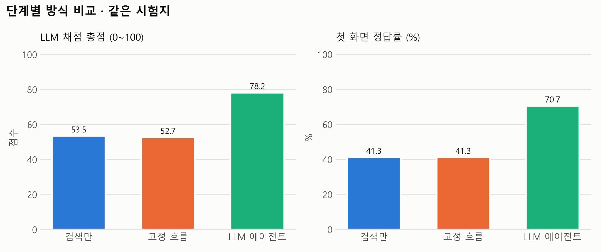
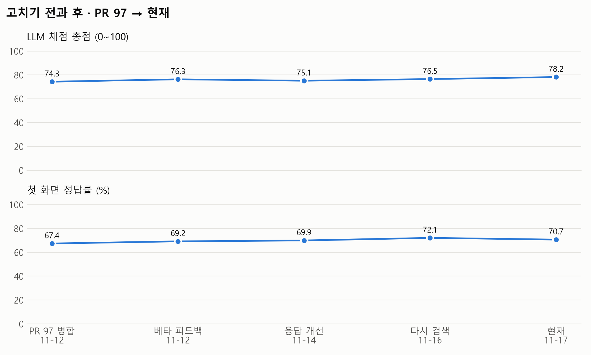
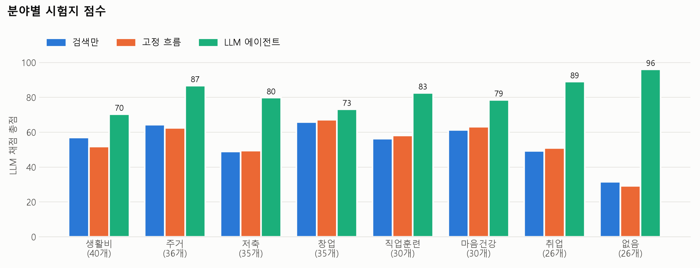
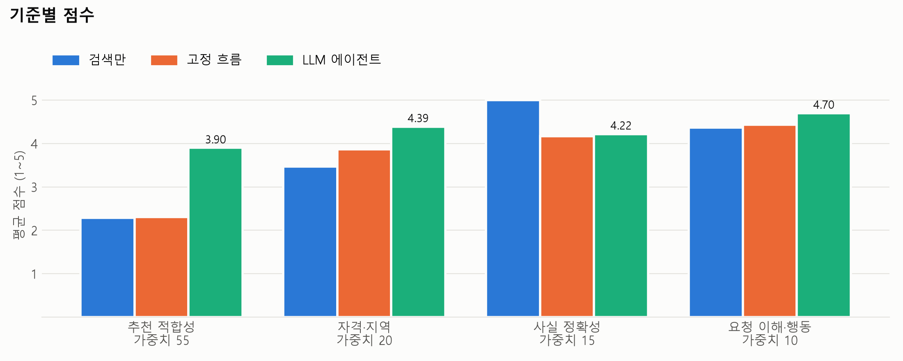

# 청년 정책 에이전트 평가서

> 담당: 권세진 · 평가일 2026-11-18 · 대상: 청년 정책 추천 에이전트 (`backend/policies/`)
> 같은 질문 327개를 같은 조건으로 돌리고, 에이전트보다 큰 LLM 이 기준 4개로 채점했다. 방식별(검색만 · 고정 흐름 · LLM 에이전트)과 버전별(PR 97 → 현재)로 비교한다.

## 1. 요약

| | 검색만 | 고정 흐름 | **LLM 에이전트 (현재)** |
|---|---|---|---|
| LLM 채점 총점 (100점) | 53.5 | 52.7 | **78.2** |
| 첫 화면 정답률 | 41.3% | 41.3% | **70.7%** |
| 지역 정확도 | – | 85.1% | **100%** |
| 평균 응답 시간 | 0.3초 | 0.3초 | 9.5초 |

- LLM 에이전트가 규칙만 쓰는 고정 흐름보다 총점 **25.5점**, 첫 화면 정답률 **29.4%p** 높다. 차이는 대부분 추천 적합성(평균 2.3 → 3.9점)에서 났다.
- PR 97(11-12)에서 현재(11-17)까지 총점 74.3 → 78.2, 첫 화면 정답률 67.4% → 70.7%.
- 맞는 정책이 없는 질문 26개에 모두 억지 추천을 하지 않았다.
- 약한 곳: 대화형 질문(사용자 평가셋 65.6점), 생활비 · 창업 분야(70점대 초반), 응답 시간 9.5초.

## 2. 평가 기준과 가중치

기준마다 1~5점을 매기고 `(점수 − 1) ÷ 4 × 가중치`를 더해 0~100점을 낸다. 1점은 0, 5점은 가중치 그대로다.

| 기준 | 가중치 | 묻는 것 |
|---|---|---|
| 추천 적합성 | **55** | 보여 준 정책이 사용자의 고민에 실제로 맞나 |
| 자격 · 지역 | 20 | 받을 수 없는 정책(다른 지역 · 나이 초과 · 마감)을 추천하지 않았나, 모르는 조건을 '확인 필요'로 보였나 |
| 사실 정확성 | 15 | 정책명 · 기간 · 금액 · 서류 · 링크가 DB 원문과 같나, 수급을 단정하지 않았나 |
| 요청 이해 · 행동 | 10 | 찾기 · 상세 · 다른 담당으로 넘기기 · 되묻기 · 확답 거절 중 맞는 행동을 했나 |

**점수를 높게 · 낮게 주는 경우 (실제 채점 사례)**

| 기준 | 5점 | 1~2점 |
|---|---|---|
| 추천 적합성 | "비전공자인데 개발자 되고 싶어" → 국민취업지원제도 (직업훈련 지원) | "자격증 따는 데 돈이 너무 들어" → 결과 없음 (응시료 지원 사업이 있는데 못 찾음) |
| 자격 · 지역 | "예비창업자 지원금" → 사는 곳에 해당하고, 나이 조건이 불명확한 정책은 '확인 필요' 표시 | "부산에서 서울로 이사 갈 예정…" → 부산 정책만 추천 |
| 사실 정확성 | 정책명 · 기간 · 지원 내용 · 링크가 원문과 일치 | "주식 투자 지원금" → 근거 없이 다른 지역에 있다고 단정 |
| 요청 이해 · 행동 | "사회초년생 저축 지원" → 바로 저축 정책을 찾음 | "아까 추천해준 것 중에 두 번째 정책…" → 정책을 묻지 않고 새로 검색 |

- 정답 정책 후보가 여러 개면 하나만 나와도 충분하다(두 고민 질문은 고민마다 하나). 맞는 정책이 없는 질문은 아무것도 보여 주지 않아야 5점이다.
- 가입 지역을 대화에서 한 번 확인하는 질문은 허용된 동작이라 감점하지 않는다.

**기준을 데이터로 고친 과정** (7절 참고)
- 처음에는 '안내 명확성'(10)까지 5개였다. 에이전트의 안내가 고정 문구뿐이라, 이 점수는 문구가 있는지와 추천 적합성을 다시 재는 데 그쳤다(현재 에이전트에서 추천 적합성과 같은 점수 156/327건). 총점에서 빼고 참고 값으로만 남겼다.
- 추천 적합성이 이 기능의 핵심이라 30 → 55로 올렸다. 요청 이해 · 행동은 77~89%가 5점이라 변별력이 낮고, 사실 정확성은 아무 말도 하지 않은 '검색만' 방식이 전부 5점을 받아서 둘 다 낮췄다.

## 3. 테스트셋 (327개)

| 평가셋 | 파일 | 수 | 기대 출력 |
|---|---|---|---|
| 분야별 시험지 | `policies/eval/agent_cases.json` | 258 | 정답 정책 묶음 (정책 없음 26개는 추천 0개) |
| 사용자 평가셋 | `policies/eval/profile_cases.json` | 60 (+ 후속 질문 23) | 가입 프로필 · 첫 행동 · 찾을 지역 · 꼭 할 일 · 하면 안 되는 일 |
| 개발 중 요청 기록 | `policies/eval/history_cases.json` | 9 | 기록에서 사용자가 말한 기대 행동 |

- 분야별 시험지 구성: 생활비 40 · 주거 36 · 저축 35 · 창업 35 · 직업훈련 30 · 마음건강 30 · 취업 26 · 정책 없음 26.
- 사용자 평가셋은 권세진이 만든 원래 질문 40개와 가입 지역 · 나이를 바꾼 시나리오 20개다(`청년정책_질문과_기대행동.xlsx` 와 같은 내용). 20개는 분야별 시험지와 문장이 같지만 프로필과 기대 행동이 달라 따로 센다. 질문 문장 기준으로는 307개다.
- 요청 기록은 Claude Code · Codex 에 요청했던 기록에서 사용자가 챗봇에 넣어 본 문장과 지적한 문제를 골랐다(베타 테스트 S44~S46, 다른 지역 추천, 문장 속 지역, 분야 질문 등). 15개를 골랐고, 라우터 확인 질문 6개는 분야별 시험지에 이미 있어 뺐다.
- 데이터 기준일은 평가셋 파일에 고정했다(분야별 2026-11-16). 마감된 정책이 저절로 빠져 점수가 바뀌지 않게 하기 위해서다.

## 4. 채점 방법

- **에이전트 실행**: `python manage.py policy_agent_eval` 이 질문마다 실제 대화를 끝까지 돌린다(질문 읽기 · 행동 고르기 · 검색 · 자격 · 돌아보기 · 카드). 사용자 평가셋은 가입 지역 확인이 나오면 "예"로 잇고 후속 질문까지 보낸다. 질문마다 1회 실행.
- **LLM 채점(LLM-as-judge)**: `gpt-6.2-sol` (에이전트는 `gpt-6-luna`). 자기 답을 후하게 보지 않도록 더 큰 모델을 따로 쓴다. LangChain 체인(`프롬프트 | LLM | PydanticOutputParser`)으로 부르고, 기준별 점수와 근거 한 문장을 받는다(`policies/judge.py`).
- **사실 대조**: 채점자에게 화면에 나온 정책의 DB 원문 요약(정책명 · 사는 곳 해당 · 나이 · 신청 상태 · 지원 내용 · 서류 · 링크)을 함께 준다. 채점자의 기억이 아니라 DB 값으로 판단하게 한다.
- **코드 지표**: 첫 화면 정답률(정답 묶음이 첫 화면 3개 안에), 지역 정확도(사용자 평가셋의 기대 지역으로 검색), 오류 · 실패 건수, 평균 LLM 호출 수 · 응답 시간.
- **비교 방식**

| 방식 | 내용 |
|---|---|
| 검색만 | 문장 그대로 벡터 · 키워드 검색 상위 3개 (읽기 · 자격 · 돌아보기 · 대화 없음) |
| 고정 흐름 | 규칙 + 자격 거르기, LLM 없음 (`--mode rules`) |
| LLM 에이전트 | 질문 읽기 · 행동 고르기 · 돌아보기 · 다시 검색 (`--mode agent`) |
| 버전별 | PR 97 병합 이후 정책 코드를 바꾼 커밋 5개를 각각 같은 평가셋 · 같은 채점자로 |

- 비용: 채점 1회(327개)에 입력 약 80만 · 출력 약 8.5만 토큰, 약 2.5달러. 전체 7회 약 17달러.

## 5. 결과

### 5-1. 방식별



| | 검색만 | 고정 흐름 | LLM 에이전트 |
|---|---|---|---|
| 총점 | 53.5 | 52.7 | **78.2** |
| 첫 화면 정답률 | 41.3% | 41.3% | **70.7%** |
| 지역 정확도 | – | 85.1% | **100%** |
| 오류 · 실패 | 1 | 0 | 0 |
| 치명적 오류 (채점자 지적) | 3 | 11 | 3 |
| 평균 LLM 호출 · 응답 시간 | 0회 · 0.3초 | 0회 · 0.3초 | 3.6회 · 9.5초 |

- '검색만'의 오류 1건은 지역을 먼저 물어야 하는 질문(P57)이라 검색할 지역이 없어 실행이 멈춘 것이다. 에이전트 오류가 아니라 비교 방식의 한계다.
- 고정 흐름의 치명적 오류 11건은 대부분 잘못된 지역으로 검색한 경우다. 규칙만으로는 문장 속 지역("이번에는 서울 관악구 기준으로…")을 읽지 못해 가입 지역으로 찾았다. 나머지는 "아까 두 번째 정책"처럼 직전 추천을 가리키는 질문에 새 목록으로 답한 경우다.

### 5-2. 버전별 (고치기 전과 후)



| 버전 | 바꾼 것 | 총점 | 첫 화면 정답률 |
|---|---|---|---|
| `ca824113` PR 97 병합 (11-12) | RAG 검색 · LLM 행동 고르기 · 돌아보기, 챗봇 연결 | 74.3 | 67.4% |
| `34391b7d` 베타 피드백 (11-12) | 베타 피드백 반영, 채팅 · 저장 UX (PR 117) | 76.3 | 69.2% |
| `3ea53c5f` 응답 개선 (11-14) | 표 카드 · 지역 드롭다운 · 분야 안내 (김나은) | 75.1 | 69.9% |
| `d982618b` 다시 검색 (11-16) | 다시 검색 · 지역 바꾼 뒤 재검색 · 고민 문장도 정책으로 (PR 128) | 76.5 | 72.1% |
| `581c5ea9` 현재 (11-17) | 링크가 없거나 기관 메인뿐이면 온통청년 상세 (PR 136) | **78.2** | **70.7%** |

- 총점은 PR 97 대비 3.9점, 첫 화면 정답률은 3.3%p 올랐다. 정답률은 다시 검색(11-16) 72.1%가 가장 높고 현재는 70.7%다.
- 버전 사이 차이(1~2점)는 질문마다 한 번씩 돌린 결과라 LLM 변동으로 생길 수 있는 크기다. 한 단계씩의 차이보다 PR 97 → 현재 전체 흐름을 본다.

### 5-3. 분야별 (분야별 시험지 258개)



| 분야 | 질문 | 검색만 | 고정 흐름 | LLM 에이전트 | 에이전트 첫 화면 정답률 |
|---|---|---|---|---|---|
| 생활비 | 40 | 56.9 | 51.8 | 70.4 | 52% |
| 주거 | 36 | 64.3 | 62.5 | 86.8 | 86% |
| 저축 | 35 | 48.9 | 49.4 | 79.8 | 66% |
| 창업 | 35 | 65.9 | 67.2 | 73.2 | 60% |
| 직업훈련 | 30 | 56.3 | 58.2 | 82.6 | 60% |
| 마음건강 | 30 | 61.4 | 63.1 | 78.6 | 70% |
| 취업 | 26 | 49.3 | 50.9 | 89.0 | 88% |
| 정책 없음 | 26 | 31.6 | 29.3 | 96.1 | 100% |

- 모든 분야에서 에이전트가 가장 높다. 차이가 가장 큰 곳은 '정책 없음'(억지 추천을 하지 않음)과 취업 · 저축이다.
- 생활비(70.4)와 창업(73.2)이 가장 낮다. 생활비는 질문이 막연하고 정답이 지역 사업에 흩어져 있고, 창업은 '검색만'도 66점이라 에이전트가 더한 몫이 작다.

### 5-4. 기준별



| 기준 (1~5) | 검색만 | 고정 흐름 | LLM 에이전트 |
|---|---|---|---|
| 추천 적합성 | 2.29 | 2.31 | **3.90** |
| 자격 · 지역 | 3.47 | 3.87 | **4.39** |
| 사실 정확성 | 5.00 | 4.17 | 4.22 |
| 요청 이해 · 행동 | 4.37 | 4.43 | **4.70** |

- '검색만'의 사실 정확성 5.00은 정책명만 보이고 설명을 하지 않아 틀릴 것이 없었기 때문이다. 이 기준의 가중치를 낮춘 이유다.

### 5-5. 평가셋별 (LLM 에이전트)

| 평가셋 | 질문 | 총점 | 첫 화면 정답률 |
|---|---|---|---|
| 분야별 시험지 | 258 | 81.2 | 71.3% |
| 사용자 평가셋 | 60 | 65.6 | 61.1% (정답을 정한 18개) |
| 요청 기록 | 9 | 74.9 | – |

- 사용자 평가셋이 가장 낮다. 이미 추천한 정책을 이름으로 가리키는 후속 질문, 확답 거절, 나이 충돌 안내처럼 대화 맥락이 필요한 질문이 많기 때문이다.

## 6. 사람 검수

- 무작위로 고른 20건(분야별 시험지 12 · 사용자 평가셋 5 · 요청 기록 3, `policies/eval/human_review.md`)을 사람이 같은 기준으로 확인했다.
- 채점자는 사람보다 엄격하게 평가했다. 특히 **DB 에서 확인되지 않는 자격 조건을 안내하지 않았다는 이유로 감점**하는 경우가 있었다(가구소득 · 국적 · 거주기간 등). 에이전트는 원문에 없는 자격을 말하지 않도록 설계돼 있어, 이 감점은 에이전트 잘못이라기보다 채점 기준의 한계다.
- 그러나 대체로 사람 점수와 크게 다르지 않아, 방식 · 버전 간 비교에 쓰기에는 충분하다고 판단했다.
- 사람 점수 칸을 채우면 기준별 일치율(평균 절대 차 · ±1점 안 일치율)을 숫자로 낼 수 있다.

## 7. 채점 기준을 고친 과정

시범 9건을 돌려 채점 근거를 읽고 고쳤다.

| 문제 | 원인 | 고친 것 |
|---|---|---|
| 정상 링크를 "원문과 다르다"고 감점 | 원문 링크가 없으면 온통청년 상세 주소를 쓰는 규칙을 채점자가 몰랐다 | DB 원문 요약에 '챗봇 링크'를 넣고 규칙을 프롬프트에 적음 |
| 정답 하나만 맞아도 되는데 "나머지가 빠졌다"고 감점 | 정답 목록의 뜻을 '전부 나와야 함'으로 읽었다 | 질문 종류를 넘기고 "하나면 충분, 두 고민은 고민마다" 규칙 |
| 막연한 질문에 빈 답이 95점 | "정책 없음 질문은 빈 답이 5점"만 있었다 | 빈 답이 5점인 경우를 정답이 '없음'인 질문으로 좁힘 |
| 가입 지역 확인을 "바로 검색하지 않았다"고 감점 | 평가셋 규칙상 허용된 동작인 줄 몰랐다 | 허용 동작이라고 프롬프트에 적음 |

그 뒤 전체 채점 결과의 점수 분포를 보고 안내 명확성을 총점에서 빼고 가중치를 바꿨다(2절). 기준별 점수가 저장돼 있어 다시 채점하지 않고 총점만 다시 계산했다(`--rescore`).

## 8. 한계

- **질문마다 1회 실행**: LLM 은 실행마다 답이 조금씩 다르다. 1~2점 차이는 우연일 수 있다.
- **채점자도 LLM**: 사람보다 엄격하고, DB 에 없는 자격 안내를 요구하는 경향이 있다(6절).
- **"다른 지역에는 있어요" 안내**: 에이전트가 전국으로 다시 찾아 한 말이지만, 채점자는 화면에 나온 정책의 원문만 받아 확인하지 못하고 사실 정확성을 깎은 경우가 있다.
- **정답 세트**: 정답은 사람이 고른 것이라 빠진 정책이 있을 수 있다. 정답이 없는 찾기 질문은 LLM 채점만 본다.
- **라우터는 따로**: 이 평가는 청년 정책 담당에 질문이 들어온 뒤부터 본다. 고민 문장이 정책 담당으로 가는지(정책 단독 117 → 237/258, 11-16)는 라우팅 평가에서 따로 본다.

## 9. 개선할 점

1. **이름으로 가리킨 정책 찾기**: "방금 추천한 청년도전지원사업 서류 알려줘"처럼 이름을 말해도 상세로 가지 못하고 다시 찾는다(요청 기록 H01).
2. **생활비 · 창업 분야**: 막연한 질문의 분야 짐작과 검색어를 보강한다.
3. **응답 시간**: 평균 9.5초. 행동 고르기와 질문 읽기를 한 번의 LLM 호출로 합치는 것을 검토한다.
4. **채점 기준**: "원문에 없는 자격은 요구하지 않는다"를 다음 평가부터 채점 프롬프트에 넣는다.
5. **더 넓은 질문**: 데이터의 공식 분류 19개 × 50개 = 950개 질문(`청년정책_평가질문_19분야_950개.txt`)으로 분야 일치율 · 빈 답 비율을 볼지 정한다(기대 출력이 없어 정답률은 낼 수 없다).

## 10. 다시 돌리는 법

```bash
cd backend
CHAT_LLM=live JUDGE_MODEL=gpt-6.2-sol python manage.py policy_agent_eval --label s-agent --mode agent \
  --file policies/eval/agent_cases.json policies/eval/profile_cases.json policies/eval/history_cases.json \
  --runs 1 --judge --no-route --workers 6
python manage.py policy_agent_eval --label s-agent --rescore   # 가중치만 바꿨을 때
```

- `--mode search` · `--mode rules` 로 비교 방식을 돌린다. 버전 비교는 커밋마다 임시 worktree 를 만들고 `judge.py` · `evaluate.py` · `policy_agent_eval.py` · 평가셋을 복사해 같은 명령을 돌린다.
- 그래프: `scripts/policy_eval_charts.py` (matplotlib 은 프로젝트 의존성이 아니라 따로 만든 가상환경에서).
- 결과는 `policies/eval/results/` 에 남는다(저장소에 넣지 않음).
