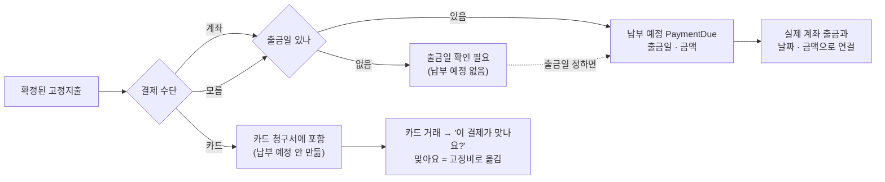
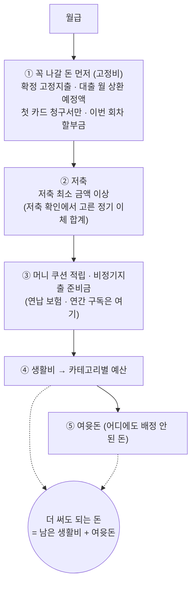
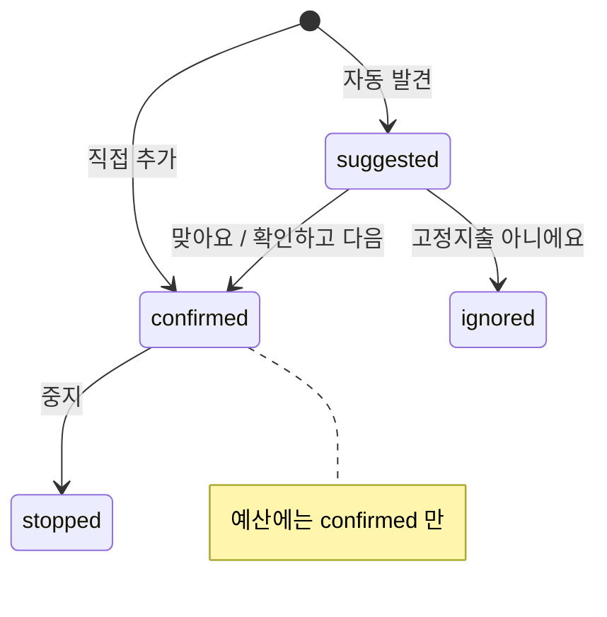
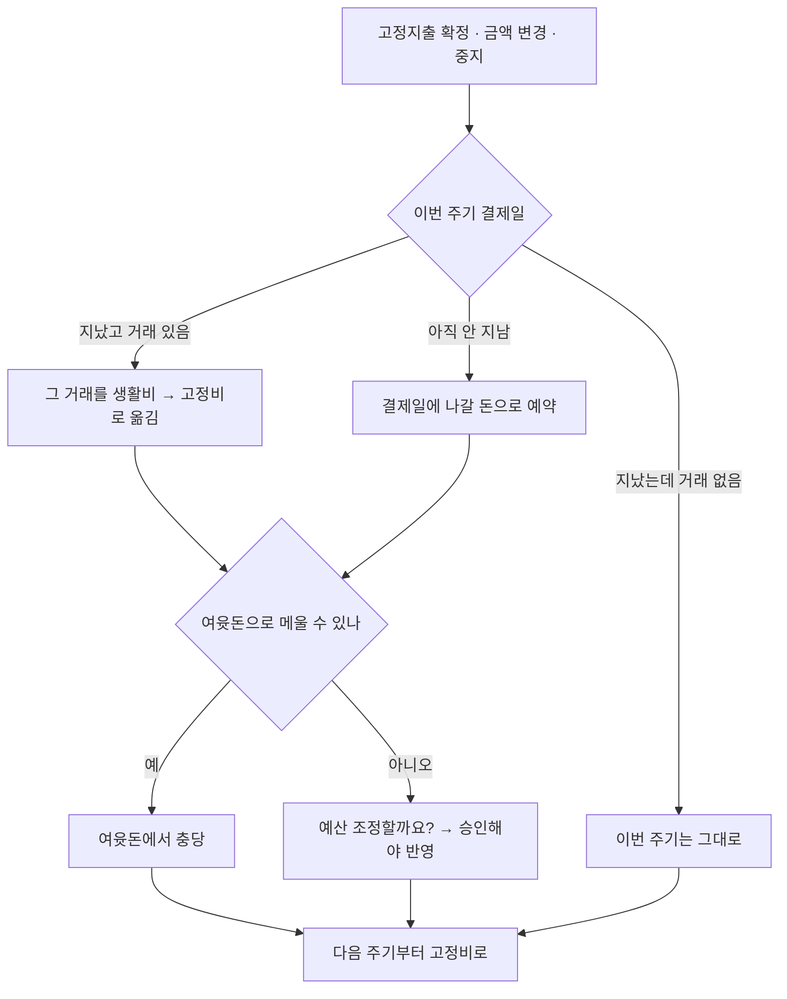
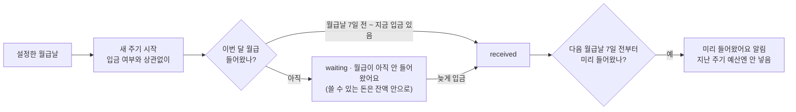
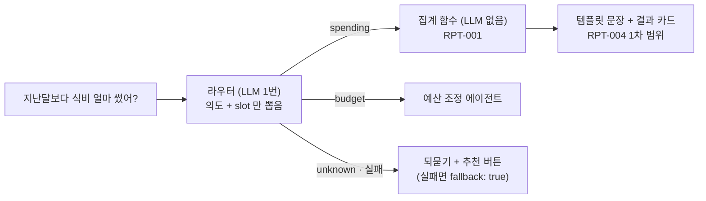

# 머니쿠션 결정 기록 — 2026-10-21

> API 명세 작업 중 정한 것들을 한 곳에 모았다. 근거 문서: `docs/API_RULES.md` · 요구사항정의서(10/21 수정분) · `docs/DB_MODELS.md` · `docs/머니쿠션_API_명세_목록_2026-10-21.md`
> **맨 위 ★ 표 = 이번에 달라진 것.** 내 이름 칸에 ●가 있는 줄만 내 명세에 반영하면 된다.
> **공통 규칙은 10/24(금)까지 더 바꾸지 않는다.** 새로 생기는 질문은 각자 파일의 '확인 필요'에 모은다.

---

## ★ 이번 고정지출 명세로 달라진 것 — 팀원 참고 (10/21 저녁 검수)

> `fixed.md`를 쓰면서 **고정지출 밖에도 영향이 가는 규칙**이 생겼다. 내 명세 · 구현에 해당하는 줄만 보면 된다.
> ● = 내 명세에 반영 필요 · ○ = 알고만 있으면 됨

| # | 달라진 것 | 한 줄 설명 | 나은 | 혜리 | 세진 |
|---|---|---|:-:|:-:|:-:|
| 1 | 계좌 · 카드 `status` **3가지** | `connected` · `relogin`(다시 연결 필요) · `disconnected` — 둘 아님 | ○ | ● | ● |
| 2 | 표에 없는 칸을 보내면 **400** | `status`처럼 서버가 정하는 칸을 보내도 400 "이 칸은 보낼 수 없어요." | ● | ● | ● |
| 3 | 할 수 없는 상태의 항목은 **404** | 목록에 안 나오는 항목(중지 · 무시)은 없는 것처럼 404 | ● | ● | ● |
| 4 | 요청 번호 **만드는 때** | 입력 팝업 = 열 때 / 버튼 하나짜리(확정 · 무시 · 승인) = 누를 때 | ● | ● | ● |
| 5 | 납부 예정(`PaymentDue`)은 **출금일이 있을 때만** | 출금일 모르면 안 만들고 "출금일 확인 필요" | ● | ○ | ● |
| 6 | **카드 고정지출은 카드값 안에** | 따로 납부 예정을 안 만든다 → 카드 청구서에서 또 빼면 안 됨 | ● | ○ | ● |
| 7 | 고정지출 결제 확인 (10/22 수정) | **카드**: '이 결제가 맞나요?' / 여러 건이면 [고르기]. **계좌**: 맞는 출금이 1건이면 자동 연결, **여러 건이면 [고르기]**(고른 출금을 그 회차에 연결). 고르기 전까지는 월세가 고정비 · 생활비에 두 번 잡혀 보일 수 있어 홈 '꼭 나갈 돈'에도 "출금 확인 필요 [고르기]" | ○ | ● | ○ |
| 8 | 연결된 카드 거래는 **고정비** | `spending_allocation.funding_bucket = fixed` → 생활비 카테고리 사용액에서 빠짐 | ● | ● | ● |
| 9 | 자동 발견 후보는 **근거 거래의 계좌 · 카드로 채움** | 감지 로직이 후보 만들 때 결제 수단도 같이 저장 | ○ | ● | ○ |
| 10 | 고정지출 · **저축 최소 금액**이 바뀌면 **이전 초안 만료** | 바뀌기 전 숫자로 만든 예산 초안은 승인 불가 (COM-005 `EXPIRED`) | ● | ● | ○ |
| 11 | `category_detail` **삭제** · `created_at` **추가** | 고정지출 표만. 쓰고 있었다면 빼기 | ○ | ○ | ○ |
| 12 | 납부 예정은 **이번 주기 1건씩** (C-15) | 확정할 때 이번 주기 것, 다음 주기 것은 그 주기에 홈 · 예산을 **처음 열 때** 만듦 (매일 도는 작업 없음). 출금 매칭은 이 납부 예정과 짝지음 | ● | ● | ○ |
| 13 | 결제 하나는 **고정지출 하나에만** 연결 | 다른 고정지출에 이미 연결된 카드 결제는 후보에서 빠지고, 보내면 400 | ○ | ● | ○ |
| 14 | 급여 주기는 **설정한 월급날**에 바뀜 (home.md H-01) | 실제 입금은 상태로만 알림(들어옴 · 아직 · 다음 달 월급 미리 옴). 미리 온 월급은 지난 주기 예산에 안 넣음. 월급날 ~ 입금일 사이에 쓴 돈은 새 주기 생활비. '이번 주기'를 쓰는 곳은 모두 이 주기 | ● | ● | ● |
| 15 | 저축 후보는 **고정지출과 따로** (`savings.md`, 새 표 `recurring_saving`) | [저축이에요] → 받는 계좌 용도 = 저축 · 근거 이체 `saving` / [아니에요] → `own_transfer`. 저축 최소 금액 = 확정 합계(계산). 감지 조건: 같은 받는 계좌 · ±3일 · 같은 금액 · 3달 연속 | ● | ● | ○ |

### 고정지출 돈은 어느 길로 빠지나 — 한 번만 센다

| 결제 수단 | 납부 예정 | 실제 거래와 연결 | 담당이 주의할 점 |
|---|---|---|---|
| 계좌 | 출금일 있으면 만듦 | 날짜 ±3일 · 금액으로 자동 | 혜리: 출금 거래 ↔ 납부 예정 매칭 |
| 카드 | **안 만듦** | 사용자에게 '맞나요?' 1번 | 세진: 카드 청구서에서 또 빼지 않기 (첫 청구서만 선차감) |
| 모름 | 출금일 있으면 만듦 | 카드 내역에서 발견되면 "카드로 바꿀까요?" | — |

### 고정지출을 고치면 납부 예정은 이렇게 따라간다

이미 냈거나 일부 낸 회차는 **절대 안 바꾼다.** 바뀌는 건 이번 주기(급여일 ~ 다음 급여일 전날) 미납분과 앞으로의 회차뿐.

| 이렇게 고치면 | 아직 안 낸 납부 예정 |
|---|---|
| 금액 변경 | 새 금액으로 |
| 출금일 변경 (28일 → 15일) | 날짜도 15일로 |
| 출금일을 새로 정함 (모름 → 28일) | 그때 만듦 |
| 출금일 비움 (→ 모름) | 취소 |
| 계좌 → 카드 | 취소 (카드값과 두 번 빼지 않게) |
| 중지 | 취소 → 그 돈은 여윳돈으로 |

### 상태마다 되는 일 (고정지출 예시 · 다른 상태 있는 API도 같은 방식)

| 상태 | 목록 | 수정 PATCH | 중지 DELETE | 확정 · 무시 |
|---|:-:|:-:|:-:|:-:|
| 후보 `suggested` | ✅ | ✅ 200 | ❌ 404 (→ 무시로) | ✅ 200 |
| 확정 `confirmed` | ✅ | ✅ 200 | ✅ 204 | 확정 ✅ 200 (이미 그 상태) · 무시 ❌ 400 |
| 중지 `stopped` | — | ❌ 404 | ✅ 204 (이미 그 상태) | ❌ 400 |
| 무시 `ignored` | — | ❌ 404 | ❌ 404 | 무시 ✅ 200 (이미 그 상태) · 확정 ❌ 400 |

- 주소로 고른 항목(`/fixed/<id>/`)이 그 동작을 못 하는 상태면 **404**, 본문으로 여러 개 고른 것(`recurringIds`) 중 하나라도 안 되면 **400 · 전부 저장 안 함**.

### 요청 번호(`Idempotency-Key`) 언제 만드나

| 화면 모양 | 만드는 때 | 예 |
|---|---|---|
| 입력 팝업 → [저장] | **팝업을 열 때** | 고정지출 추가, 거래 직접 등록 |
| 버튼 하나로 끝 | **버튼을 누를 때** | 후보 [맞아요] · [아니에요], 예산 [승인], 조정안 [승인] |
| 공통 | 응답 오기 전 다시 보내면 **같은 번호**, 끝나면 버림 | 저장 중엔 버튼 잠금 |

### 검증 — 실제 DB로 돌려 봄

로컬 PostgreSQL 16에 마이그레이션 0003~0006을 올리고 고정지출 API 6개를 시제품으로 만들어 **74개 상황을 모두 통과**했다 (같은 번호 동시 2번 · 남의 ID · 상태별 404 · 납부 예정 따라가기 포함). 구현할 때 이 순서대로 만들면 된다.

---

## 0. 명세 쓰는 사람용 체크리스트 (이것만 보면 됨)

| ✔ | 규칙 | 예시 |
|---|---|---|
| ☐ | 카테고리는 키 `category`, 값은 **영문 대문자 코드**. 응답엔 `categoryName`도 | `"category": "FOOD"` |
| ☐ | 계좌 · 카드는 요청엔 ID만, 응답엔 객체 `{ id, displayName, status }` | `"displayName": "국민 급여통장 · ****5678"` |
| ☐ | `status` 값은 `connected` · `relogin` · `disconnected` | |
| ☐ | **주소가 틀리면 404, 내용이 틀리면 400** | `/fixed/abc/` → 404 · 본문 `paymentAccountId: "abc"` → 400 |
| ☐ | 본문 ID 오류는 없는 것 · 남의 것 · 고를 수 없는 것 **같은 문구**, 하나라도 틀리면 **전부 저장 안 함** | `"선택할 수 없는 계좌예요."` |
| ☐ | 에러 `fields`는 **칸 오류가 있을 때만**. 칸과 상관없는 오류엔 아예 없음 (`{}`도 아님) | |
| ☐ | 수정(PATCH): **안 보낸 칸 = 그대로, `null` = 비우기**, 필수 칸에 `null` = 400 | `{ "amount": 720000 }` |
| ☐ | 목록은 `{ "items": [...] }`, 옆에 `period` · `summary` · `next` 키 추가 OK | |
| ☐ | 같은 요청 두 번: 이미 그 상태면 **성공**(예: 이미 중지 → 204) | |
| ☐ | 새로 만들기 · 승인 요청은 **요청 번호** `Idempotency-Key` 헤더. 팝업은 열 때, 버튼 하나짜리는 누를 때 만든다 | 서버 `@idempotent()` · 화면 `apiSend(..., { requestKey })` |
| ☐ | 보내는 값 표에 **없는 칸**(서버가 정하는 `status` 등)을 보내면 400 | `"이 칸은 보낼 수 없어요."` |
| ☐ | 그 동작을 못 하는 **상태**의 항목을 주소로 고르면 404 | 중지된 고정지출 PATCH → 404 |
| ☐ | 돈은 원 단위 정수, 비율은 0~100. **증감률은 예외**(음수 · 100 초과, 비교 대상 0원이면 `null`) | |
| ☐ | 매월 N일이 없는 달은 **그 달 말일** (2/31 → 2/28) | |
| ☐ | 금액 범위는 API마다 명세에 적기 | 고정지출 1,000원 ~ 1억 원 |
| ☐ | 새 주소는 `api_urls.py` **맨 끝 `not_found` 줄 위에**, ID 자리는 `<uuid:이름>` | |

---

## 1. 카테고리 코드

| 순서 | 코드 | 이름 | 순서 | 코드 | 이름 |
|---|---|---|---|---|---|
| 1 | `FOOD` | 식비 | 7 | `BEAUTY` | 뷰티·미용 |
| 2 | `HOUSING_TELECOM` | 주거·통신 | 8 | `EDUCATION` | 교육 |
| 3 | `TRANSPORT_CAR` | 교통·차량 | 9 | `CULTURE_LEISURE` | 문화·여가 |
| 4 | `HOUSEHOLD` | 생활용품 | 10 | `TRAVEL_LODGING` | 여행·숙박 |
| 5 | `FASHION_SHOPPING` | 패션·쇼핑 | 11 | `ETC` | 기타 (예산 칸 있음) |
| 6 | `MEDICAL_HEALTH` | 의료·건강 | 12 | `UNCLASSIFIED` | 확인 필요 (고를 수 없음) |

저축 · 투자 · 대출 상환 · 카드값은 **카테고리가 아니다.**

---

## 2. 돈이 나뉘는 순서

| 원칙 | 내용 |
|---|---|
| **같은 돈은 한 번만** | 고정비는 생활비를 나누기 전에 한 번만 뺀다 |
| 저축 최소 금액 | ML 결과의 저축이 최소 금액보다 작으면 최소까지 올리고 생활비에서 줄인다 (BUD-003) |
| 카드값 | **첫 청구서만** 예산에서 먼저 뺀다. 그 뒤는 카드로 긁을 때 이미 빠진 돈이라 연결만 (TXN-009) |
| 승인된 예산 | 말없이 바꾸지 않는다. 바꾸려면 사용자 승인 (BUD-005) |

---

## 3. 고정지출 기준 (`fixed.md` C-01 ~ C-16 — 10/21 모두 해결, 명세 확정)

| 번호 | 질문 | 결정 |
|---|---|---|
| C-01 | 카테고리 | **필수**. 10개 + 기타. 이름으로 미리 골라 둠. 저축 · 투자 · 대출 · 카드값은 고정지출 아님 |
| C-02 | 결제 수단 | **계좌 / 카드 / 모름** 중 하나 (선택). 고를 수 있는 건 관리 대상 입출금 계좌 · 카드. 연결 해제돼도 고정지출은 유지 |
| C-03 | 금액 · 출금일 | 금액 **1,000원 ~ 1억 원**. 출금일 1~31 또는 비움(모름). 없는 날은 말일 |
| C-04 | 주기 · 상태 · 출처 | **매월만**. 상태 `suggested` → `confirmed` / `ignored`, 중지 `stopped`. 출처 `manual` · `detected`. 예산엔 확정만 |
| C-05 | 수정 | 안 보낸 칸 = 그대로, `null` = 비우기. 결제 수단 바꿀 땐 두 칸 같이 |
| C-06 | 수정 · 중지 시점 | 아직 안 낸 회차만 새 금액. 이번 주기 차액은 여윳돈으로. 중지는 이번 주기 미납분 취소. 다시 시작 = 새로 추가 |
| C-07 | 목록 · 합계 | 후보 + 확정 함께, **후보 먼저**, 확정은 출금일순. 합계는 확정만. 후보 확정 · 무시 API 2개 추가 |
| C-08 | 같은 비용 두 번 빼기 | 돈이 나가는 길은 하나로만. 카드 고정지출은 카드값 안에 포함. 이름으로 안 맞추고 실제 결제(근거 거래)로 |
| C-09 | 에러 `fields` | 칸 오류가 있을 때만 |
| C-10 | 두 번 저장 | 버튼 잠금 + 요청 번호(`Idempotency-Key`) |
| C-11 | 잘못된 ID | 주소 = 404 (JSON), 본문 = 400 |
| C-12 | 카드 거래 연결 | 연결하면 그 거래를 고정비로(`spending_allocation=fixed`), 근거 거래에 추가해 가맹점 기억 |
| C-14 | 결제 확인 | 목록의 `evidenceSuggestion` → [맞아요]는 PATCH `evidenceTransactionId`, [아니에요]는 저장 안 함. **1차는 카드만**. 비슷한 결제가 **여러 건**이면 "N건 있어요 [고르기]" → `evidenceSuggestion.candidates`(최대 5건)에서 고름. 다른 고정지출에 이미 연결된 결제는 후보에서 빼고 보내면 400 | · **10/22: 계좌도 출금이 여러 건이면 [고르기]** (혜리 거래 명세)
| 검수 | 10/21 저녁 | `relogin` 추가 · 납부 예정은 출금일 있을 때만 · 후보는 `created_at` 최신순 · 자동 후보는 근거 거래의 계좌 · 카드로 채움 · `categoryDetail` 삭제 · 출금일 생략 = 모름 · 중지 · 무시 항목 수정 404 · 초안 만료 확정 |
| C-15 | 납부 예정 만드는 때 | **이번 주기 1건씩**. 확정할 때 이번 주기 것, 다음 주기 것은 그 주기에 홈 · 예산을 **처음 열 때** (배치 없음). 수정 · 중지의 '이번 달'은 '이번 주기'로 |
| C-16 | 추가 팝업 결제 고르기 | **1차엔 뺌.** 저장하면 목록에서 바로 "이 결제가 맞나요?" / [고르기]로 고름 (결제 목록을 줄 API가 없어서). 추가 API의 `evidenceTransactionId`는 남겨 둠 |

### 고정지출 상태 흐름

### 자동 감지 조건 (커피는 안 잡힘)

| 조건 | 기준 |
|---|---|
| 한 달에 한 번 | 같은 받는 곳으로 한 달에 1건 |
| 날짜 | 매달 같은 날 ±3일 |
| 금액 | 같은 금액 (변동 청구는 ±10%) |
| 기간 | 3달 연속 |

- 등록된 **대출**과 맞는 출금 → 고정지출 후보 X, 대출 상환 완료로 연결
- **내 계좌끼리 정기 이체** → 저축 후보로 질문

### 온보딩 뒤에 고정지출이 생기거나 바뀌면

---

## 3-1. 홈 기준 (`home.md` — 기본만)

| 번호 | 질문 | 결정 |
|---|---|---|
| H-01 | 월급이 일찍 · 늦게 오면 주기는? | **항상 설정한 월급날에 새 주기.** 월급(관리 대상 입출금 계좌로 들어온 **월 실수령액 80% 이상** 입금, **내 계좌끼리 이체 제외**)은 상태로만: `received` · `waiting`(아직) · `unknown`(실수령액 모름). 월급날 **7일 전**부터 들어온 건 그 달 월급으로 봄(명절). 다음 달 월급이 미리 오면 `nextSalaryEarlyOn`으로 알리고 지난 주기 예산엔 안 넣음(따로 빼 둠). 늦게 오는 동안은 쓸 수 있는 돈을 실제 잔액 안으로(예산 명세에서). 주기는 `budget_cycle`(`active` · `closed`)에 저장. *처음엔 '입금일에 새 주기'로 정했다가 바꿈 — 늦게 오면 이번 달 밥값이 지난달 초과로 잡혀서* |
| H-03 | 홈 '확인할 거래 수'는 어떻게 세나 (10/22 혜리) | **전체 기간**에서 카테고리가 '확인 필요'(`UNCLASSIFIED`)인 **소비 거래** 수. 거래 목록에 들어가는 거래와 같다(출금 중 소비만, 카드값으로 중복된 계좌 출금 제외). 홈 숫자 = `GET /api/finance/transactions/?category=UNCLASSIFIED`(기간 없이)의 `summary.needsReviewCount`. 목록은 **최신순** |
| H-02 | 저축용 입출금 계좌도 잔액 합계에? | **넣음** (화면 이름이 '입출금 계좌 잔액') |
| H-05 | 출금일 모르는 고정지출 알림? | **알림** — `needsPaydayCount` → "출금일을 확인할 고정지출 N건 ›" |
| H-06 | 예산 없을 때 · 온보딩 전 홈 | 예산 없으면 **안내 카드**. 온보딩 전이면 **홈 대신 온보딩으로** (화면이 판단) |
| H-07 | DB 코드 (10/22 혜리 · 나은) | 원칙: **API 값 = DB 값, 소문자 영어**. 아래 코드표 |
| — | 예산 숫자 (오늘 쓸 수 있는 돈 · 남은 생활비 · 여윳돈 · 쿠션) | 이번엔 안 씀. 응답은 `budget: null` (ML 후) |

**DB 코드표 (H-07, 10/22 확정)**

| 테이블.칸 | 값 |
|---|---|
| `connection.status` | `connected` · `relogin` · `disconnected` (해제하면 `disconnected` + `disconnected_at`) |
| `financial_transaction.direction` | `in` · `out` |
| `bank_account.account_type` | `demand`(입출금, CODEF `resAccountDeposit` = `11`) · `deposit`(예적금) · `other` — CODEF 원래 코드는 `field_states.codef_deposit_code`에. `savings`는 용도 칸(`budget_role`)과 헷갈려서 안 씀 |
| `financial_transaction.transaction_type` | `spending` · `transfer` · `own_transfer` · `card_payment` · `saving` · `loan_repayment` · `income` — 적금으로 보낸 이체는 저축으로 확인되면 `saving`, 그 밖의 내 계좌끼리 이체는 `own_transfer` |
| `financial_transaction.confirmation_state` | `needs_review` · `suggested` · `confirmed` — 카테고리가 `UNCLASSIFIED`면 `needs_review` |
| `financial_transaction.classification_source` | `user` · `rule` · `ml` · `llm` |
| 계좌 · 카드 연결 상태 | 따로 저장하지 않고 `connection.status`에서 가져옴 |

---

## 3-2. 정기 저축 기준 (`savings.md`, 10/22)

| 번호 | 질문 | 결정 |
|---|---|---|
| S-01 | 어디에 저장 | **새 표 `recurring_saving`** (30번째). 고정지출 표에 섞으면 고정비에 저축이 들어가 두 번 빠질 위험 |
| S-02 | 저축 최소 금액 | **확정된 정기 저축 합계를 계산** (저장 안 함). 지킬 돈 저축(`savings_floor`)은 이보다 작을 수 없음 |
| S-03 | 직접 추가 | **받음** (다른 은행 적금 등) |
| S-04 | 수정 · 중지 | **고정지출과 같게** |
| S-05 | 감지 조건 | 내 계좌끼리 이체 · 같은 받는 계좌 · ±3일 · **같은 금액** · **3달 연속** |
| S-06 | [저축이에요] | `confirmed` + 받는 계좌 `budget_role = savings` + 근거 이체 `transaction_type = saving` |
| S-07 | [아니에요] | `ignored`(다시 안 물음) + 근거 이체 `own_transfer` |
| S-08 | 온보딩 [확인하고 다음] | 후보마다 **다 골라야** 넘어감 (자동 확정 금지, TXN-005). 확정 목록 · 무시 목록을 각각 보냄 |
| S-09 | 직접 추가 값 | 이름 · 금액 필수, 이체일 · 보내는/받는 계좌 선택 |
| S-10 | 이번 달 저축 실적 | 이 명세 밖 (거래 · 예산 쪽) |

---

## 3-3. 연결 · 거래 · 챗봇 결정 (혜리 명세 리뷰, 10/22)

| | 질문 | 결정 |
|---|---|---|
| A | 챗봇 소비 분석 기본 기간 | **달력월** (BUD-004 · RPT-001 · 거래 목록과 같게). 비교 기본 = 지난달. CHT-006 문구 고침 |
| B | 같은 구매(체크카드 승인 + 계좌 출금) | **카드 승인이 대표**, 이어진(`SAME_PURCHASE`) 계좌 출금은 목록 · 합계 · 소비 분석에서 뺌 |
| C | 달이 안 끝났을 때 지난달 대비 | **같은 날짜까지 잘라서 비교** (10/1~21 vs 9/1~21). 문장에 "9월 같은 기간보다" 표시 |
| D | 승인 전 예산 초안은 언제 만료? | **고정지출 또는 저축 최소 금액이 바뀔 때만** (★10 + S-12, 10/22 PR #29 리뷰로 저축 추가). 거래 분류 변경 · 계좌 선택 변경으로는 만료 안 함. 승인된 이번 달 예산은 그대로, 다음 달부터 반영 |
| E | DB 코드 | 메시지 `role` = `user` · `bot`, `contentType` = `text` · `card`, 작업 `status` = `queued` · `running` · `succeeded` · `failed` · `canceled`, `taskType` 예: `budget_adjust` |
| F | 연결 해제 때 그 계좌 · 카드로 나가는 고정지출 · 정기 저축 | **해제 확인 창에서 같이 그만할지 물어봄** (기본은 체크 안 함). 체크한 것만 기존 중지 API로 중지(이번 주기 미납 납부 예정도 취소), 나머지는 그대로 남고 "연결 해제됨 · 다시 고르기" 표시. 새 API 없음 |
| ★7 | 계좌 출금이 여러 건 맞을 때 | 혜리 안대로 **사용자가 [고르기]** (위 ★ 표 7번) |
| G | 지난 주기 미납을 홈에서 얼마나 보여 주나 (PR #26 리뷰) | 출금 **연결** 기간(±3일)과 미납 **안내** 기간을 나눔. 출금일 +3일까지 "출금 확인 중" → 지나면 `needs_review` **"미납 확인 필요"** → **다음 월급날 전까지** 홈 '꼭 나갈 돈'에 표시, 그 뒤엔 홈에서 빠짐(기록은 남음). 늦게 낸 출금은 [고르기]로 연결(출금일 −3일 ~ 오늘). 1차엔 '따로 냈어요' 버튼 없음 |
| H | 정기 저축 후보의 계좌 수정 (PR #29 리뷰) | **후보는 보내는 · 받는 계좌를 못 바꿈**(400) → 틀렸으면 [아니에요] 후 직접 추가. 확정 항목은 바꿀 수 있고 지난 `saving` 이체는 그대로 (savings.md S-11) |
| I | 저축 관리 화면 | 저축 확인 화면에 **[+ 저축 직접 추가]**, **마이 > 정기 저축** 메뉴로 같은 화면 다시 열기(확정 저축 수정 · 중지). 고정지출과 같은 방식 |
| J | 소비 분석 카드 칸 (10/22 취합 검수) | **chat.md 하나로.** 세진 안(spending-analysis.md A-2)에서 **`topSpending`**(가장 많이 쓴 카테고리, 동률은 모두) · **`comparison: { available, reason }`**(비교 가능 여부 · 이유)만 가져옴. 이름은 줄이지 않음: `previousTotal` · `categories[].previousAmount`. **`coverage`(자료 빠진 날짜) · `scope` 객체는 1차에 안 넣음**(2차). `reason`은 1차에 `not_requested` · `previous_incomplete` 두 개 |
| K | 계좌 · 카드 선택 저장 규칙 (10/22 취합 검수) | **같은 규칙: 보낸 목록 = 전체 선택**(빠진 건 해제). 키 `selectedAccountIds` · **`selectedCardIds`**. 빈 배열만 다름 — 계좌는 1개 이상(400), **카드는 0개 허용**(= 카드 선택 모두 해제, "카드는 나중에 연결") |
| L | 동의 저장 모양 (10/22 취합 검수) | 회원가입 동의 · 금융 동의를 **한 모양으로: 동의한 것만 보냄**(`agreed` 칸 없음). 금융 동의만 `productScope`(`bank` · `card` · `loan`) 추가. 문서 버전 표기는 **`v1`**(회원가입 화면과 같게) |
| M | 연결 해제된 것을 후보 목록에 보이나 (10/22 취합 검수) | **안 보임.** 계좌 후보 · 카드 후보 · 연결 목록 모두 해제된 연결 것은 뺌(새로 고를 수 없으니까). `disconnected`는 고정지출 · 거래처럼 **이미 연결해 쓰던 것**을 보여 줄 때만 |
| N | PM 답 10개 (10/22 2차 검수, 각 명세 '확인 필요'에서) | ① 지난달에 같은 날짜가 없으면 **지난달 말일까지** 자름 (3/1~31 vs 2/1~28) · ② '확인 필요' 금액은 **`topSpending` 순위에서 뺌**, 문장에 "분류된 소비 중" · ③ `compare`는 1차 **`prev_month`만** (`prev_week`는 2차) · ④ 챗봇 카드의 '확인 필요'는 **`unclassifiedAmount` 합계 한 줄**(목록은 거래 화면) · ⑤ 챗봇 최근 대화는 1차에 **화면이 마지막 `conversationId` 기억**, 없거나 404면 새 대화(대화 목록 API는 2차) · ⑥ 같은 범위 · 같은 버전의 유효한 동의가 있으면 **새로 안 만들고 기존 기록을 돌려줌** · ⑦ 연결 상세 화면용 API **1차 없음**(연결 목록 + 계좌 후보로 그림) · ⑧ 해제한 연결의 계좌 **`isSelected`는 그대로**(재연결 시 복원), 잔액 · 월급 찾기 · 후보에서는 빠짐, **해제 전 거래는 소비 집계에 계속 포함** · ⑨ 카드사가 없으면 "카드", 끝 4자리가 없으면 ` · ****` 생략(추측 금지) · ⑩ 고정지출이 쓰는 카드를 **선택 해제해도 고정지출 · 결제 수단은 그대로**(새로 고를 때만 검사) |
| O | 금융 공통 에러 (10/22 2차 검수) | **목록 · 조회 `GET`은 저장된 것만 읽고 CODEF를 부르지 않는다.** CODEF는 금융기관 인증 · 새 연결(`POST /api/finance/connections/`)과 다시 불러오기(`POST /api/finance/sync/`)에서만 부른다(둘 다 '결정 후'). 에러 코드: **동의 안 함 403 `consent_required`**(지금 — 카드 · 대출 · 청구서 조회, 동의 화면으로) · CODEF · 은행 응답 없음 502 `provider_unavailable` · 다시 연결 필요 409 `relogin_required` · 일부 기관만 실패하면 200 + 기관별 결과(뒤 셋은 연결 · 다시 불러오기 명세에서). 다시 연결 필요한 계좌 · 카드는 목록에서 `status: relogin`으로 보인다(이미 정함). 실패를 빈 목록 · 0원으로 바꾸지 않는다 |
| P | 대출 확인 화면 · 대출 API (10/22 2차 검수, 화면 대조) | **① 대출 보완 `PATCH /api/finance/loans/<id>/`** 받는 칸은 3개: `monthlyPayment`(1원 ~ 1억 원) · `paymentDay`(1~31, 없는 날은 말일) · `repaymentMethod`(`equal_payment` · `equal_principal` · `bullet` · `unknown`). 셋 다 `null` = 모름. 상환 완료(`repaid`) 대출은 404. 응답은 대출 한 건(8번 모양). 월 상환액 + 납부일이 둘 다 있으면 납부 예정을 만든다(고정지출과 같음). 기관 대출의 잔액 · 금리 수정은 2차 · **② 대출 보기 `GET`에 칸 3개 추가**: `paymentHistory`(지난 납부: 날짜 · 원금 · 이자, 최근 3건) · `estimatedMonthlyPayment`(지난 납부 평균, 없으면 `null`) · `overdue`(연체 여부 true · false · `null`). 값이 없으면 `null`이고 화면이 그 부분을 숨긴다 · **③ 대출 직접 등록 `POST /api/finance/loans/` 추가(1차 35번째 API)** — CODEF로 안 잡히는 학자금대출(한국장학재단) 등. `origin = manual` |
| Q | H-04 · C-17 꼭 나갈 돈의 카드 청구서 · 대출, 첫 청구서 (10/22 2차 검수) | **H-04**: 홈 `mustPay[]`에 같은 모양으로 `type: card_bill` · `loan` 추가. 카드 청구서 = 이름 "{카드사} 카드 청구서" · 날짜 **출금 예정일** · 금액 **청구 총액 − 이미 낸 금액** · `sourceId` = 청구서 ID(누르면 카드 청구서 팝업, `GET /api/finance/card-bills/<id>/`) · 출금 예정일을 알 때만. 대출 = 이름 "{기관} {상품명}" · 날짜 **매월 납부일** · 금액 **월 상환액 − 이미 낸 금액** · `sourceId` = 대출 ID(누르면 대출 확인 화면) · 월 상환액 + 납부일이 둘 다 있을 때만(P). **C-17**: 첫 카드 청구서만 미리 떼어 둔다. **미리 뗄 돈 = 첫 청구서 총액 − 이번 주기 시작일 이후 그 카드로 쓴 돈**(0보다 작으면 0). 이번 주기에 쓴 돈은 이미 생활비로 세고 있어서 빼는 것. 두 번째 청구서부터는 미리 떼지 않고 실제 출금과 연결만 한다. *구매일별로 하나씩 보던 처음 제안을 이 계산식으로 바꿈(상세 항목이 없어도 계산 가능)* |
| R | H-08 온보딩을 다 했는지 (10/22 2차 검수) | 로그인 응답 · `GET /api/auth/me/`에 **`onboardingCompleted`(true · false)** 한 칸. **첫 예산을 승인하면 true.** false면 화면이 홈 대신 온보딩 첫 단계로 보내고, 이미 저장한 값은 채워서 보여 준다. 몇 번째 단계인지(`onboardingStep`)는 1차에 안 줌 |
| S | 소비 분석에 고정지출 (10/22 2차 검수) | **넣되 따로 표시.** 소비 분석 카드의 `total` · 카테고리 금액에는 고정지출로 연결된 거래(`funding: fixed`)도 넣고, **`fixedAmount`(그중 고정지출 합계)** 칸을 추가한다. 문장: "이번 달 132만 원 썼어요. 월세 같은 고정지출 77만 원을 빼면 생활비는 55만 원이에요." 생활비 사용액(예산 · 홈)에서는 계속 뺀다(★8) |
| T | 감지 · 매칭 담당 (10/22 2차 검수) | 원칙: **그 명세를 쓴 사람이 그 매칭도 만든다.** ① **혜리** — 거래 수집 · 같은 구매(`SAME_PURCHASE`) 연결 · 거래 종류 기본 판정(입금 · 이체 · 내 계좌끼리), 그리고 **거래가 저장된 뒤 아래 매칭들을 차례로 부르는 입구 하나**(`after_transactions_saved` 같은 함수) · ② **나은** — 고정지출 후보 감지 · 저축 후보 감지 · 납부 매칭(고정지출 출금 ↔ 납부 예정, `needs_review`, 카드 결제 '맞나요?') · ③ **세진** — 카드값 출금 ↔ 카드 청구서 연결 · 첫 청구서 미리 뗄 돈 계산(Q) · 대출 상환 출금 ↔ 대출 연결 · 월 상환 추정(P). 각자 자기 함수만 만들고 혜리의 입구에 한 줄씩 등록한다 |
| U | 남은 API 18개 배분 (10/22 2차 검수) | **나은 7** — 예산 엔진 · ML 연결: 방향 PUT · 지킬 돈 GET · PUT · 추천 예산 POST · 카테고리 예산 GET · 금액 고정 PATCH · 예산 승인 POST / **세진 8** — 온보딩 입력 · 쿠션: 내 정보 GET · PUT · 급여 GET · PUT · 쿠션 GET · PATCH · 비정기 준비금 GET · 비밀번호 다시 설정 POST (쿠션 · 준비금 금액은 나은의 예산 엔진 결과를 읽음) / **혜리 3** — 금융기관 인증 · 새 연결 POST · 다시 불러오기 POST · 예산 조정안 승인 POST (CODEF 인증 · 동기화가 무거워서 개수는 적게). *처음 제안(나은 12 · 세진 6 · 혜리 2)은 PM · 예산 엔진 · 감지 매칭이 겹치는 나은에게 몰려서 바꿈* |
| V | 거래 · 연결 · 로그인 1차 범위 (10/22 2차 검수) | **거래 화면**: ① **넣음** — 거래 목록에 **월급 입금**(H-01로 찾은 월급만, 다른 입금은 안 보임)과 **남에게 보낸 이체**(`transaction_type = transfer`)도 보인다. 둘 다 소비가 아니라서 카테고리가 없고(`category: null`), 소비 합계 · 카테고리 칩 · 소비 분석 · 예산에는 안 들어간다. 화면은 "월급" · "이체" 표시. 내 계좌끼리 · 카드값 · 저축 · 대출 상환은 지금처럼 안 보임 · ② 확신도 숫자 안 보여 줌 · ③ 원천 상세(승인번호 · 거래 후 잔액) 안 함 · ④ 같은 가맹점의 과거 거래 일괄 변경 안 함(앞으로 들어올 거래만 기억) · ⑤ **편의점 · 마트 같은 다품목 가맹점은 무조건 사용자에게 물어봄**(기억 · 추천 안 함, D1 · D16) · ⑥ 분류를 '확인 필요'로 되돌리기 안 함(다른 카테고리로 고치기는 됨). **연결 · 로그인**: ⑦ 금융 동의 = **은행 필수, 카드 · 대출 선택** 승인 · ⑧ 동의 철회 안 함(2차) · ⑨ 계좌 고르기에 예적금 안 보임(입출금만) · ⑩ 로그인 실패 횟수 제한 안 함(출시 전 2차) |
| W | 친구에게 보낸 이체를 소비로 셀 수 있나 (10/22) | **사용자가 고른 이체만 소비로 센다.** 이체(`transaction_type = transfer`)는 거래 목록에 보이지만 처음엔 소비가 아니다(V ①). 사용자가 그 이체의 상세에서 **[소비로 분류하기] → 카테고리**를 고르면 그때부터 `spending`으로 바뀌어 소비 합계 · 예산 · 소비 분석에 들어간다(예: 더치페이 → 식비). **"소비 아님"으로 되돌릴 수 있다**(원래 이체였다는 표시를 남겨 둠). 규칙: ① 기본은 소비 아님 ② 이체는 '확인 필요' 숫자(H-03)에 안 들어감 ③ 받는 사람을 기억하지 않음(매번 사용자가 고름). 예산 · 소비 분석 쪽은 따로 고칠 것 없음(소비로 바뀐 거래를 원래대로 셈) |
| X | 회원가입 · 로그인 기본 규칙 (10/22, auth.md '확인 필요' 10줄) | ① **비밀번호: 8~25자, 영문 · 숫자 · 특수문자 중 2가지 이상** ② 비밀번호 확인은 화면에서만 비교, 서버엔 `password` 한 번만 ③ 이미 가입된 이메일 → 400 "이미 가입된 이메일이에요" ④ 가입 성공 201 + **자동 로그인**(바로 온보딩) ⑤ 로그인한 상태로 회원가입 요청 → 400 ⑥ 가입 두 번 눌림은 이메일 중복 검사로 막음(요청 번호 없음) ⑦ 정지 · 탈퇴 계정 로그인 → 일반 실패와 같은 문구 "이메일 또는 비밀번호를 확인해 주세요" ⑧ **[자동 로그인] 체크박스 1차 없음** — 로그인하면 14일 유지([아이디 저장]은 화면이 이메일만 기억, 서버와 무관) ⑨ 로그인 때는 비밀번호 길이 · 조합을 검사하지 않음(규칙이 바뀌어도 기존 회원이 로그인) ⑩ 로그아웃 200 `{ "ok": true }` |
| Y | 대출 직접 등록 `POST /api/finance/loans/` 받는 칸 (10/22, 결정 P ③) | 필수: `lenderName` 기관 이름(1~50자, 예: 한국장학재단) · `productName` 대출 이름(1~50자, 예: 학자금대출) · `manualBalance` 남은 금액(1원 ~ 10억 원). 선택: `manualRate` 금리(0~30, %) · `maturityDate` 만기일 · `monthlyPayment` · `paymentDay` · `repaymentMethod`(대출 보완 PATCH와 같은 3칸, P ①). 서버가 `origin = manual` · `status = repaying`으로 저장, 응답 201 = 대출 한 건(대출 보기와 같은 모양). 요청 번호(`Idempotency-Key`)는 팝업을 열 때. 월 상환액 + 납부일이 있으면 납부 예정을 만든다(P ①). 1차엔 등록 뒤 잔액 · 금리 수정은 없음(PATCH는 3칸만) |
| Z | 카드 청구서 칸 · 작은 것 3개 (10/22) | **카드 청구서**(cards.md 10번 제안 채택): `confirmationStatus`(예상 `estimated` · 확정 `confirmed` · 모름 `unknown`) · `scopeType`(카드 한 장 `card` · 카드사 합산 `issuer` · 모름 `unknown`) · `items` · `itemsState`(구매 내역 전부 · 일부 · 없음) 모두 채택, CODEF가 안 주는 값은 `null`. 홈 '꼭 나갈 돈'의 카드 청구서는 **예상 금액이면 "예상" 표시**(`mustPay[].isEstimated`). **작은 것**: ① 연결 관리 목록에 **대출 기관도 보임**(`businessType: loan`) ② 소비가 하나도 없는 기간의 챗봇 답 = **0원 카드 + "이 기간엔 소비가 없어요"** ③ 연결 목록 `items[]`에 **`accountIds` · `cardIds`** 추가(연결 해제 창에서 그 연결로 나가는 고정지출 · 저축을 찾으려고, F) |
| AA | 1차 확정 전 남은 8개 (10/24, 취합 README 4-4) | ① **카드 청구서**: `billingMonth`는 `"YYYY-MM"` 문자열(예: `"2026-10"`), 카드사 이름 `issuerName` 함께 줌, `cards` · `fetchedAt` 채택(모르면 `null`) ② **대출 `fieldStates` 채택** — 값마다 `source`(조회 · 직접 입력) · `confirmationStatus` · `confirmedAt`. 화면의 "조회됨 · 직접 입력 · 확인 필요" 표시용 ③ **대출 목록은 1차에 상환 중(`repaying`)만** 보임 ④ **회원가입 201 응답에 `onboardingCompleted: false`** (가입하면 바로 로그인 상태라 로그인 · `/me/`와 같은 모양) ⑤ ⭐ **고정지출에 연결된 이체는 소비** — 월세를 집주인에게 계좌이체로 내는 경우. 이체는 원래 소비가 아니지만(W), 확정된 고정지출과 **금액 · 날짜(±3일)가 맞아 연결되면** `transaction_type` `transfer` → `spending`, 카테고리는 그 고정지출 것, `funding: fixed`('고정' 표시). 생활비 사용액엔 안 들어가고, 소비 분석엔 `fixedAmount`로 들어감(S). **연결을 풀면 다시 `transfer`**(카테고리 · `funding` 비움). 매칭은 계좌 출금 납부 매칭과 같은 길(T, 나은) ⑥ 원래 이체였다는 표시는 새 칸 없이 거래 **`field_states.original_transaction_type`** (W로 소비가 된 이체 · ⑤로 소비가 된 이체 모두) — 되돌릴 때 이 값을 봄 ⑦ **거래 유형 필터는 1차 없음**('월급' · '이체' 표시로 구분). 입금 거래에 카테고리를 보내면 **400** 확정 ⑧ **챗봇 메시지 보내기 응답 `messages`에 사용자 메시지도 넣음** (지금 예시 그대로) |

---

## 4. 챗봇 소비 분석

| 항목 | 결정 |
|---|---|
| LLM | 문장 해석(라우터)에만. 계산 · 답 문장은 LLM 없음 |
| 1차 범위 | 총소비 · 가장 많이 쓴 곳 · 카테고리별 금액 · 비율 · **지난달 대비** |
| 답 종류 | 카테고리 없음 → 전체 / 있음 → 그 카테고리 / 비교 기준 있음 → 지난달 대비 추가 |
| 집계 API | 1차엔 따로 안 만듦 (챗봇이 집계 함수 직접 호출). 2차 화면 때 `GET /api/reports/spending/` |
| 버튼 | 누르면 라우터 건너뜀 (LLM 0번) |

---

## 5. 화면 · 흐름

| 무엇 | 결정 |
|---|---|
| 첫 설정 흐름 | 월급 → 고정지출 → **저축 확인(새 화면)** → 방향 → 지킬 돈 → 추천 예산 |
| 저축 확인 | 적금 · 청약으로 매달 보낸 이체마다 [저축이에요 / 아니에요]. 고른 합계 = 저축 최소 금액 |
| 고정지출 팝업 | 카테고리 필수 · 결제 수단 [계좌 / 카드 / 모름] · 카드면 실제 결제 고르기(선택) · 출금일 '모름' · 저장 중 버튼 잠금 |
| 1차 MVP 범위 | 알림 · 소비 분석 화면은 **2차**. 내 정보 · 온보딩 · 예산 API는 **ML 결과 후** |

---

## 6. DB 변경 — pull 받으면 `python manage.py migrate`

| migration | 내용 |
|---|---|
| `finance/0003` | 고정지출 금액 1,000원 ~ 1억 원, 출금일 1~31(비워도 됨) |
| `finance/0004` | 고정지출 상태 · 출처 코드 확정 |
| `finance/0005` | 고정지출 `category_detail`(세부 분류) 칸 삭제 |
| `finance/0006` | 고정지출 `created_at`(발견 · 등록 시각) 칸 추가 — 후보 '최근에 찾은 순' 기준 |
| `users/0007` | 요청 번호 기록 표 `idempotency_record` (29번째 표) |
| `finance/0007` | 정기 저축 표 `recurring_saving` (30번째 표, 10/22) |
| `budgets/0003` | **카테고리 12개 넣기** (데이터 마이그레이션, 10/22) — 이게 있어야 거래 · 고정지출이 저장돼요. `flush`로 DB를 비웠으면 `migrate budgets 0002` → `migrate`로 다시 넣기 |

로컬 DB에 테스트로 넣은 고정지출이 규칙에 안 맞으면(한글 상태, 1,000원 미만 등) migrate가 실패한다 → 그 테스트 행을 지우고 다시.

---

## 7. 아직 안 정한 것

| 무엇 | 영향 | 누가 |
|---|---|---|
| ~~H-04 홈 '꼭 나갈 돈'에 카드 청구서 · 대출 상환 넣는 규칙~~ → **10/22 결정 Q** | 홈 | 세진 · 나은 (문서 반영) |
| ~~H-08 온보딩 진행 단계를 어느 API가 주나~~ → **10/22 결정 R** (`onboardingCompleted`) | 로그인 뒤 홈/온보딩 이동 | 세진 (auth.md 반영) |
| `budget_cycle.status` 코드 `active` · `closed` DB에 반영 (choices + CHECK) | 급여 주기 저장 | 나은 (개발 때) |
| H-07 코드들 모델에 반영 (choices + CHECK + 마이그레이션), CODEF 계좌 저장 시 `11` → `demand` | 연결 · 거래 | 혜리 (개발 때) |
| ~~C-17 첫 카드 청구서 선차감~~ → **10/22 결정 Q** (총액 − 이번 주기 그 카드 사용액) | 예산 첫 달 · 카드 청구서 | 세진 (cards.md 반영) |
| CODEF 대출 응답 칸 확인 (금리 · 약정금액 · 연체 · 납부 내역이 실제로 오는지) | 대출 확인 화면 · 월 상환액 추정 | 세진 |
| ERD · DB 설계 문서에 남은 `category_detail` 정리 | 산출물 일치 | 나은 |
| ~~소비 분석에 고정지출(월세 등)을 넣을지~~ → **10/22 결정 S** (넣되 `fixedAmount`로 따로 표시) | 소비 분석 | 혜리 · 세진 (chat · spending-analysis 반영) |
| ~~감지 로직 담당~~ → **10/22 결정 T** (명세 쓴 사람이 매칭도, 입구는 혜리) | 연결 · 거래 · 고정지출 · 카드 · 대출 | 팀 |
| 쿠션 사용 한도 | 2차 돌발 지출 | 나은 |
| ~~ML 후 API 14개 + 결정 후 4개 배분~~ → **10/22 결정 U** (나은 7 · 세진 8 · 혜리 3) | 10/25~ | 팀 |
