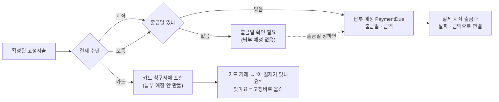
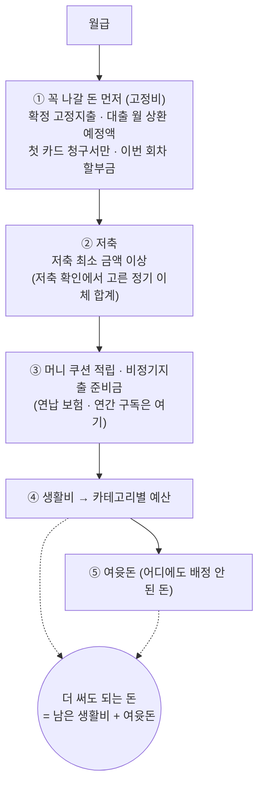
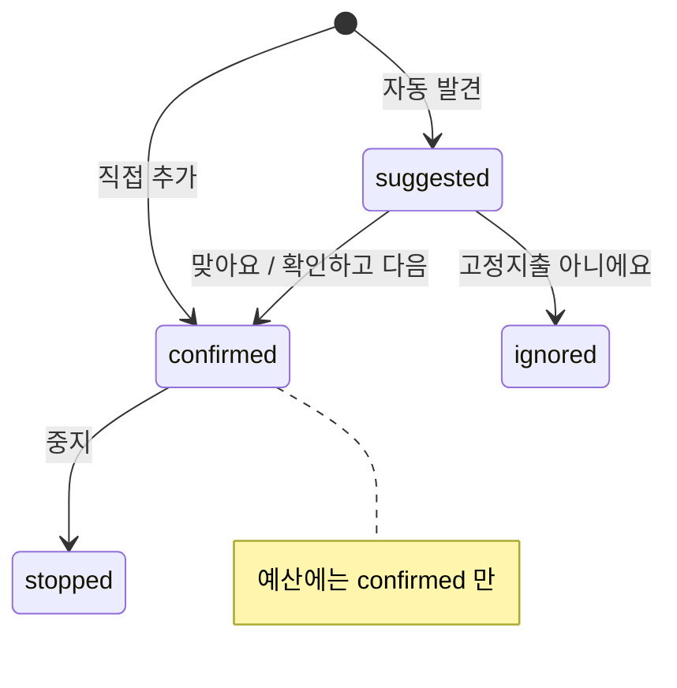
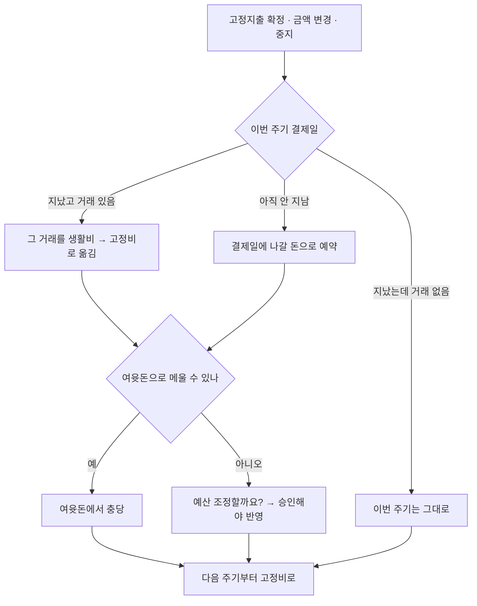
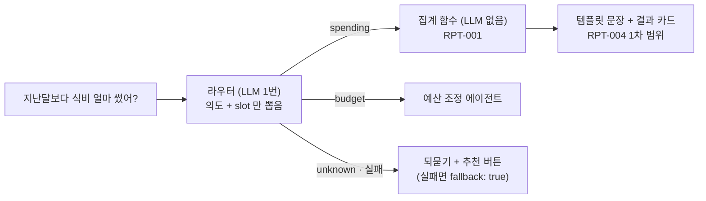

# 머니쿠션 결정 기록 — 2026-10-21

> API 명세 작업 중 정한 것들을 한 곳에 모았다. 근거 문서: `docs/API_RULES.md` · 요구사항정의서(10/21 수정분) · `docs/DB_MODELS.md` · `docs/머니쿠션_API_명세_목록_2026-10-21.md`
> **맨 위 ★ 표 = 이번에 달라진 것.** 내 이름 칸에 ●가 있는 줄만 내 명세에 반영하면 된다.
> **공통 규칙은 10/24(금)까지 더 바꾸지 않는다.** 새로 생기는 질문은 각자 파일의 '확인 필요'에 모은다.

---

## ★ 이번 고정지출 명세로 달라진 것 — 팀원 참고 (10/21 저녁 검수)

> `fixed.md`를 쓰면서 **고정지출 밖에도 영향이 가는 규칙**이 생겼다. 내 명세 · 구현에 해당하는 줄만 보면 된다.
> ● = 내 명세에 반영 필요 · ○ = 알고만 있으면 됨

| # | 달라진 것 | 한 줄 설명 | 나은 | 혜리 | 세진 |
|---|---|---|:-:|:-:|:-:|
| 1 | 계좌 · 카드 `status` **3가지** | `connected` · `relogin`(다시 연결 필요) · `disconnected` — 둘 아님 | ○ | ● | ● |
| 2 | 표에 없는 칸을 보내면 **400** | `status`처럼 서버가 정하는 칸을 보내도 400 "이 칸은 보낼 수 없어요." | ● | ● | ● |
| 3 | 할 수 없는 상태의 항목은 **404** | 목록에 안 나오는 항목(중지 · 무시)은 없는 것처럼 404 | ● | ● | ● |
| 4 | 요청 번호 **만드는 때** | 입력 팝업 = 열 때 / 버튼 하나짜리(확정 · 무시 · 승인) = 누를 때 | ● | ● | ● |
| 5 | 납부 예정(`PaymentDue`)은 **출금일이 있을 때만** | 출금일 모르면 안 만들고 "출금일 확인 필요" | ● | ○ | ● |
| 6 | **카드 고정지출은 카드값 안에** | 따로 납부 예정을 안 만든다 → 카드 청구서에서 또 빼면 안 됨 | ● | ○ | ● |
| 7 | '이 결제가 맞나요?'는 **카드만** (1차) | 계좌 출금은 납부 예정과 날짜 · 금액으로 자동 연결 | ○ | ● | ○ |
| 8 | 연결된 카드 거래는 **고정비** | `spending_allocation.funding_bucket = fixed` → 생활비 카테고리 사용액에서 빠짐 | ● | ● | ● |
| 9 | 자동 발견 후보는 **근거 거래의 계좌 · 카드로 채움** | 감지 로직이 후보 만들 때 결제 수단도 같이 저장 | ○ | ● | ○ |
| 10 | 고정지출이 바뀌면 **이전 초안 만료** | 바뀌기 전 숫자로 만든 예산 초안은 승인 불가 (COM-005 `EXPIRED`) | ● | ● | ○ |
| 11 | `category_detail` **삭제** · `created_at` **추가** | 고정지출 표만. 쓰고 있었다면 빼기 | ○ | ○ | ○ |

### 고정지출 돈은 어느 길로 빠지나 — 한 번만 센다

| 결제 수단 | 납부 예정 | 실제 거래와 연결 | 담당이 주의할 점 |
|---|---|---|---|
| 계좌 | 출금일 있으면 만듦 | 날짜 ±3일 · 금액으로 자동 | 혜리: 출금 거래 ↔ 납부 예정 매칭 |
| 카드 | **안 만듦** | 사용자에게 '맞나요?' 1번 | 세진: 카드 청구서에서 또 빼지 않기 (첫 청구서만 선차감) |
| 모름 | 출금일 있으면 만듦 | 카드 내역에서 발견되면 "카드로 바꿀까요?" | — |

### 고정지출을 고치면 납부 예정은 이렇게 따라간다

이미 냈거나 일부 낸 회차는 **절대 안 바꾼다.** 바뀌는 건 이번 달 미납분과 앞으로의 회차뿐.

| 이렇게 고치면 | 아직 안 낸 납부 예정 |
|---|---|
| 금액 변경 | 새 금액으로 |
| 출금일 변경 (28일 → 15일) | 날짜도 15일로 |
| 출금일을 새로 정함 (모름 → 28일) | 그때 만듦 |
| 출금일 비움 (→ 모름) | 취소 |
| 계좌 → 카드 | 취소 (카드값과 두 번 빼지 않게) |
| 중지 | 취소 → 그 돈은 여윳돈으로 |

### 상태마다 되는 일 (고정지출 예시 · 다른 상태 있는 API도 같은 방식)

| 상태 | 목록 | 수정 PATCH | 중지 DELETE | 확정 · 무시 |
|---|:-:|:-:|:-:|:-:|
| 후보 `suggested` | ✅ | ✅ 200 | ❌ 404 (→ 무시로) | ✅ 200 |
| 확정 `confirmed` | ✅ | ✅ 200 | ✅ 204 | 확정 ✅ 200 (이미 그 상태) · 무시 ❌ 400 |
| 중지 `stopped` | — | ❌ 404 | ✅ 204 (이미 그 상태) | ❌ 400 |
| 무시 `ignored` | — | ❌ 404 | ❌ 404 | 무시 ✅ 200 (이미 그 상태) · 확정 ❌ 400 |

- 주소로 고른 항목(`/fixed/<id>/`)이 그 동작을 못 하는 상태면 **404**, 본문으로 여러 개 고른 것(`recurringIds`) 중 하나라도 안 되면 **400 · 전부 저장 안 함**.

### 요청 번호(`Idempotency-Key`) 언제 만드나

| 화면 모양 | 만드는 때 | 예 |
|---|---|---|
| 입력 팝업 → [저장] | **팝업을 열 때** | 고정지출 추가, 거래 직접 등록 |
| 버튼 하나로 끝 | **버튼을 누를 때** | 후보 [맞아요] · [아니에요], 예산 [승인], 조정안 [승인] |
| 공통 | 응답 오기 전 다시 보내면 **같은 번호**, 끝나면 버림 | 저장 중엔 버튼 잠금 |

### 검증 — 실제 DB로 돌려 봄

로컬 PostgreSQL 16에 마이그레이션 0003~0006을 올리고 고정지출 API 6개를 시제품으로 만들어 **74개 상황을 모두 통과**했다 (같은 번호 동시 2번 · 남의 ID · 상태별 404 · 납부 예정 따라가기 포함). 구현할 때 이 순서대로 만들면 된다.

---

## 0. 명세 쓰는 사람용 체크리스트 (이것만 보면 됨)

| ✔ | 규칙 | 예시 |
|---|---|---|
| ☐ | 카테고리는 키 `category`, 값은 **영문 대문자 코드**. 응답엔 `categoryName`도 | `"category": "FOOD"` |
| ☐ | 계좌 · 카드는 요청엔 ID만, 응답엔 객체 `{ id, displayName, status }` | `"displayName": "국민 급여통장 · ****5678"` |
| ☐ | `status` 값은 `connected` · `relogin` · `disconnected` | |
| ☐ | **주소가 틀리면 404, 내용이 틀리면 400** | `/fixed/abc/` → 404 · 본문 `paymentAccountId: "abc"` → 400 |
| ☐ | 본문 ID 오류는 없는 것 · 남의 것 · 고를 수 없는 것 **같은 문구**, 하나라도 틀리면 **전부 저장 안 함** | `"선택할 수 없는 계좌예요."` |
| ☐ | 에러 `fields`는 **칸 오류가 있을 때만**. 칸과 상관없는 오류엔 아예 없음 (`{}`도 아님) | |
| ☐ | 수정(PATCH): **안 보낸 칸 = 그대로, `null` = 비우기**, 필수 칸에 `null` = 400 | `{ "amount": 720000 }` |
| ☐ | 목록은 `{ "items": [...] }`, 옆에 `period` · `summary` · `next` 키 추가 OK | |
| ☐ | 같은 요청 두 번: 이미 그 상태면 **성공**(예: 이미 중지 → 204) | |
| ☐ | 새로 만들기 · 승인 요청은 **요청 번호** `Idempotency-Key` 헤더. 팝업은 열 때, 버튼 하나짜리는 누를 때 만든다 | 서버 `@idempotent()` · 화면 `apiSend(..., { requestKey })` |
| ☐ | 보내는 값 표에 **없는 칸**(서버가 정하는 `status` 등)을 보내면 400 | `"이 칸은 보낼 수 없어요."` |
| ☐ | 그 동작을 못 하는 **상태**의 항목을 주소로 고르면 404 | 중지된 고정지출 PATCH → 404 |
| ☐ | 돈은 원 단위 정수, 비율은 0~100. **증감률은 예외**(음수 · 100 초과, 비교 대상 0원이면 `null`) | |
| ☐ | 매월 N일이 없는 달은 **그 달 말일** (2/31 → 2/28) | |
| ☐ | 금액 범위는 API마다 명세에 적기 | 고정지출 1,000원 ~ 1억 원 |
| ☐ | 새 주소는 `api_urls.py` **맨 끝 `not_found` 줄 위에**, ID 자리는 `<uuid:이름>` | |

---

## 1. 카테고리 코드

| 순서 | 코드 | 이름 | 순서 | 코드 | 이름 |
|---|---|---|---|---|---|
| 1 | `FOOD` | 식비 | 7 | `BEAUTY` | 뷰티·미용 |
| 2 | `HOUSING_TELECOM` | 주거·통신 | 8 | `EDUCATION` | 교육 |
| 3 | `TRANSPORT_CAR` | 교통·차량 | 9 | `CULTURE_LEISURE` | 문화·여가 |
| 4 | `HOUSEHOLD` | 생활용품 | 10 | `TRAVEL_LODGING` | 여행·숙박 |
| 5 | `FASHION_SHOPPING` | 패션·쇼핑 | 11 | `ETC` | 기타 (예산 칸 있음) |
| 6 | `MEDICAL_HEALTH` | 의료·건강 | 12 | `UNCLASSIFIED` | 확인 필요 (고를 수 없음) |

저축 · 투자 · 대출 상환 · 카드값은 **카테고리가 아니다.**

---

## 2. 돈이 나뉘는 순서

| 원칙 | 내용 |
|---|---|
| **같은 돈은 한 번만** | 고정비는 생활비를 나누기 전에 한 번만 뺀다 |
| 저축 최소 금액 | ML 결과의 저축이 최소 금액보다 작으면 최소까지 올리고 생활비에서 줄인다 (BUD-003) |
| 카드값 | **첫 청구서만** 예산에서 먼저 뺀다. 그 뒤는 카드로 긁을 때 이미 빠진 돈이라 연결만 (TXN-009) |
| 승인된 예산 | 말없이 바꾸지 않는다. 바꾸려면 사용자 승인 (BUD-005) |

---

## 3. 고정지출 기준 (`fixed.md` C-01 ~ C-14)

| 번호 | 질문 | 결정 |
|---|---|---|
| C-01 | 카테고리 | **필수**. 10개 + 기타. 이름으로 미리 골라 둠. 저축 · 투자 · 대출 · 카드값은 고정지출 아님 |
| C-02 | 결제 수단 | **계좌 / 카드 / 모름** 중 하나 (선택). 고를 수 있는 건 관리 대상 입출금 계좌 · 카드. 연결 해제돼도 고정지출은 유지 |
| C-03 | 금액 · 출금일 | 금액 **1,000원 ~ 1억 원**. 출금일 1~31 또는 비움(모름). 없는 날은 말일 |
| C-04 | 주기 · 상태 · 출처 | **매월만**. 상태 `suggested` → `confirmed` / `ignored`, 중지 `stopped`. 출처 `manual` · `detected`. 예산엔 확정만 |
| C-05 | 수정 | 안 보낸 칸 = 그대로, `null` = 비우기. 결제 수단 바꿀 땐 두 칸 같이 |
| C-06 | 수정 · 중지 시점 | 아직 안 낸 회차만 새 금액. 이번 달 차액은 여윳돈으로. 중지는 이번 달 미납분 취소. 다시 시작 = 새로 추가 |
| C-07 | 목록 · 합계 | 후보 + 확정 함께, **후보 먼저**, 확정은 출금일순. 합계는 확정만. 후보 확정 · 무시 API 2개 추가 |
| C-08 | 같은 비용 두 번 빼기 | 돈이 나가는 길은 하나로만. 카드 고정지출은 카드값 안에 포함. 이름으로 안 맞추고 실제 결제(근거 거래)로 |
| C-09 | 에러 `fields` | 칸 오류가 있을 때만 |
| C-10 | 두 번 저장 | 버튼 잠금 + 요청 번호(`Idempotency-Key`) |
| C-11 | 잘못된 ID | 주소 = 404 (JSON), 본문 = 400 |
| C-12 | 카드 거래 연결 | 연결하면 그 거래를 고정비로(`spending_allocation=fixed`), 근거 거래에 추가해 가맹점 기억 |
| C-14 | 결제 확인 | 목록의 `evidenceSuggestion` → [맞아요]는 PATCH `evidenceTransactionId`, [아니에요]는 저장 안 함. **1차는 카드만** |
| 검수 | 10/21 저녁 | `relogin` 추가 · 납부 예정은 출금일 있을 때만 · 후보는 `created_at` 최신순 · 자동 후보는 근거 거래의 계좌 · 카드로 채움 · `categoryDetail` 삭제 · 출금일 생략 = 모름 · 중지 · 무시 항목 수정 404 · 초안 만료 확정 |
| C-15 | 납부 예정 만드는 때 | **미정** — 제안: 확정할 때 이번 주기 1건, 다음 회차는 새 급여 주기 시작 때 (나은 · 예산) |

### 고정지출 상태 흐름

### 자동 감지 조건 (커피는 안 잡힘)

| 조건 | 기준 |
|---|---|
| 한 달에 한 번 | 같은 받는 곳으로 한 달에 1건 |
| 날짜 | 매달 같은 날 ±3일 |
| 금액 | 같은 금액 (변동 청구는 ±10%) |
| 기간 | 3달 연속 |

- 등록된 **대출**과 맞는 출금 → 고정지출 후보 X, 대출 상환 완료로 연결
- **내 계좌끼리 정기 이체** → 저축 후보로 질문

### 온보딩 뒤에 고정지출이 생기거나 바뀌면

---

## 4. 챗봇 소비 분석

| 항목 | 결정 |
|---|---|
| LLM | 문장 해석(라우터)에만. 계산 · 답 문장은 LLM 없음 |
| 1차 범위 | 총소비 · 가장 많이 쓴 곳 · 카테고리별 금액 · 비율 · **지난달 대비** |
| 답 종류 | 카테고리 없음 → 전체 / 있음 → 그 카테고리 / 비교 기준 있음 → 지난달 대비 추가 |
| 집계 API | 1차엔 따로 안 만듦 (챗봇이 집계 함수 직접 호출). 2차 화면 때 `GET /api/reports/spending/` |
| 버튼 | 누르면 라우터 건너뜀 (LLM 0번) |

---

## 5. 화면 · 흐름

| 무엇 | 결정 |
|---|---|
| 첫 설정 흐름 | 월급 → 고정지출 → **저축 확인(새 화면)** → 방향 → 지킬 돈 → 추천 예산 |
| 저축 확인 | 적금 · 청약으로 매달 보낸 이체마다 [저축이에요 / 아니에요]. 고른 합계 = 저축 최소 금액 |
| 고정지출 팝업 | 카테고리 필수 · 결제 수단 [계좌 / 카드 / 모름] · 카드면 실제 결제 고르기(선택) · 출금일 '모름' · 저장 중 버튼 잠금 |
| 1차 MVP 범위 | 알림 · 소비 분석 화면은 **2차**. 내 정보 · 온보딩 · 예산 API는 **ML 결과 후** |

---

## 6. DB 변경 — pull 받으면 `python manage.py migrate`

| migration | 내용 |
|---|---|
| `finance/0003` | 고정지출 금액 1,000원 ~ 1억 원, 출금일 1~31(비워도 됨) |
| `finance/0004` | 고정지출 상태 · 출처 코드 확정 |
| `finance/0005` | 고정지출 `category_detail`(세부 분류) 칸 삭제 |
| `finance/0006` | 고정지출 `created_at`(발견 · 등록 시각) 칸 추가 — 후보 '최근에 찾은 순' 기준 |
| `users/0007` | 요청 번호 기록 표 `idempotency_record` (29번째 표) |

로컬 DB에 테스트로 넣은 고정지출이 규칙에 안 맞으면(한글 상태, 1,000원 미만 등) migrate가 실패한다 → 그 테스트 행을 지우고 다시.

---

## 7. 아직 안 정한 것

| 무엇 | 영향 | 누가 |
|---|---|---|
| C-15 납부 예정(`PaymentDue`)을 언제 만드나 | 예산 · 홈 '남은 결제액' · 출금 매칭 | 나은 |
| ERD · DB 설계 문서에 남은 `category_detail` 정리 | 산출물 일치 | 나은 |
| 소비 분석에 고정지출(월세 등)을 넣을지 | 세진(집계) · 나은(예산) | 팀 — 추천: 소비 분석엔 포함, 생활비 사용액에선 제외 |
| 감지 로직 담당 (고정지출 · 저축 후보 · 대출 · 카드 매칭) | 혜리에게 몰릴 수 있음 | 팀 |
| 카테고리 초기 데이터(data migration) | 개발 시작 전 필수 | 나은 |
| 저축 후보 보기 · 확인 API 목록 추가 | 저축 확인 화면 | 나은 |
| `connection.status` DB 코드 (API는 connected · relogin · disconnected) | 혜리 | 혜리 |
| 쿠션 사용 한도 | 2차 돌발 지출 | 나은 |
| ML 후 API 14개 + 결정 후 4개 배분 | 10/25~ | 팀 — 제안: 나은 12 · 세진 6 · 혜리 2 |
